<div align="center">

# fnOS Monitor

**飞牛 NAS 的桌面状态屏**

让负载、流量、容量与温度，一眼可见。

ESP32-P4 · 7 英寸触控 · 1024 × 600 · 原生 LVGL · HTTPS 配对

[界面预览](#界面预览) · [快速开始](#快速开始) · [硬件要求](#硬件要求) · [开发与验证](#开发与验证) · [文档导航](#文档导航)

</div>

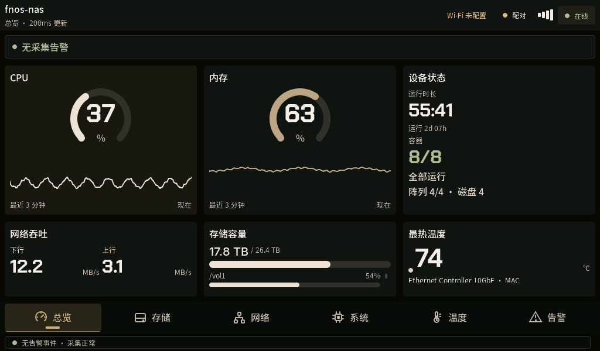

**一个独立屏幕，持续呈现 NAS 的运行状态。** fnOS 配套应用负责采集，ESP32-P4 开发板负责显示；日常查看负载、传输、存储和温度，直接看仪表、趋势与状态。遇到异常，再进入对应页面和详情。

本项目由开发板固件和飞牛配套应用组成。当前界面面向 **Waveshare ESP32-P4-WIFI6-Touch-LCD-7B 的 1024×600 横屏**，采用 CUKTECH 仪表语言、近黑背景与黄色交互焦点。

> 图中均为当前源码通过真实 LVGL 渲染的演示画面，使用通用设备名称、合成读数和固定测试指纹；不是个人 NAS 快照或物理屏幕照片。[图片来源与复现](docs/images/ui-2026-10-14/README.md)。

## 产品特性

| 一眼掌握 | 按需深入 | 清楚可信 |
| --- | --- | --- |
| **六张首页状态卡**：CPU、内存、运行时长、服务、网络、容量与温度 | **六个专用页面**：总览、存储、网络、系统、温度和告警 | **状态分开表达**：实时、旧值、无数据、权限不足和离线 |
| **真实采样趋势**：CPU、内存、温度；网速曲线集中在网络页 | **动态设备清单**：卷、阵列、磁盘、网口、容器和温度通道随数据创建 | **真实零值保留**：缺失和采集失败使用占位与原因 |
| **连续阻尼读数**：数字、环表和条形顺滑跟随变化 | **筛选与只读详情**：长名称和长清单通过换行、滚动继续查看 | **HTTPS 设备配对**：在屏幕核对证书指纹，无需写入 NAS 管理员密码 |

点击底部导航直达页面，横向拖动跟随手指；清单支持纵向滚动。温度多通道手动展开，设备身份与展开选择保持关联。夜间模式与显示参数可配置。

## 界面预览

首页总览见上方主图。以下为另外五个主页面，点击图片可查看 1024×600 原图。

### 存储 · 看清容量与阵列

已用、总量与可用空间集中呈现；按卷、阵列和磁盘筛选，查看占用、同步进度与读写活动。

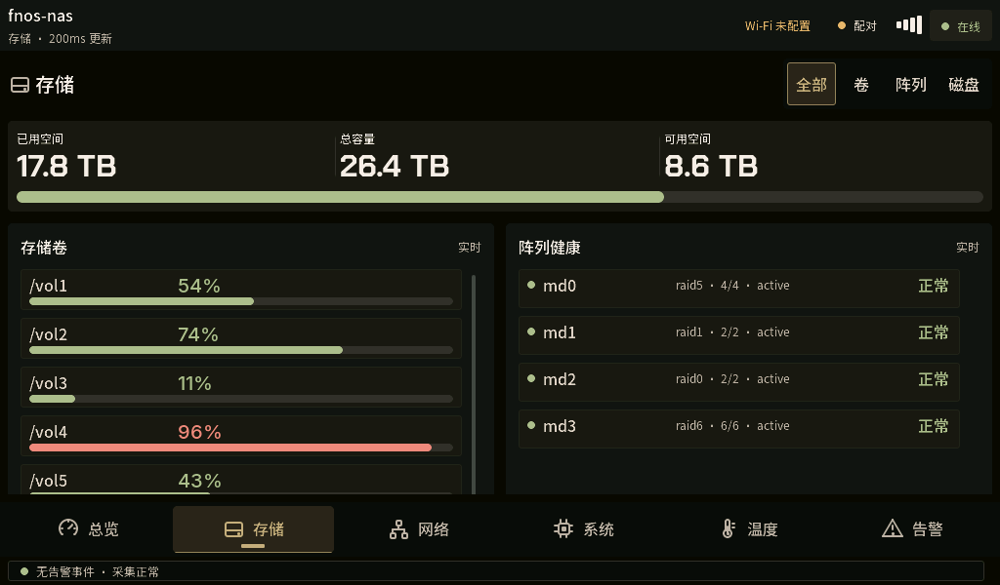

### 网络 · 看清收发与近期波动

上行、下行、合计与采集延迟配合双线趋势；各接口展示链路状态和占用。**网速曲线仅在网络页显示。**

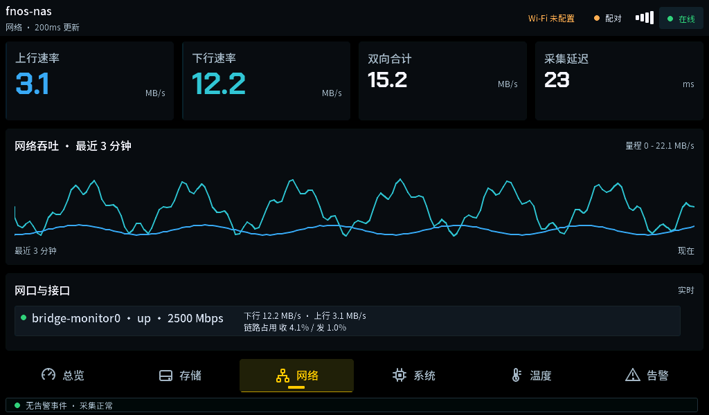

### 系统 · 看清服务与硬件

系统摘要、容器运行状态和硬件温度放在同一页；容器、硬件可分别筛选，资源字段按采集能力显示。

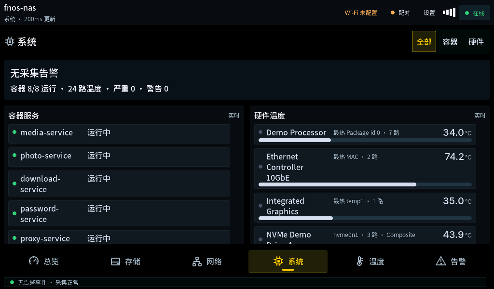

### 温度 · 找到最热的来源

最高读数与近期趋势优先；下方按设备分组，滚动访问完整清单，点击设备展开各温度通道。

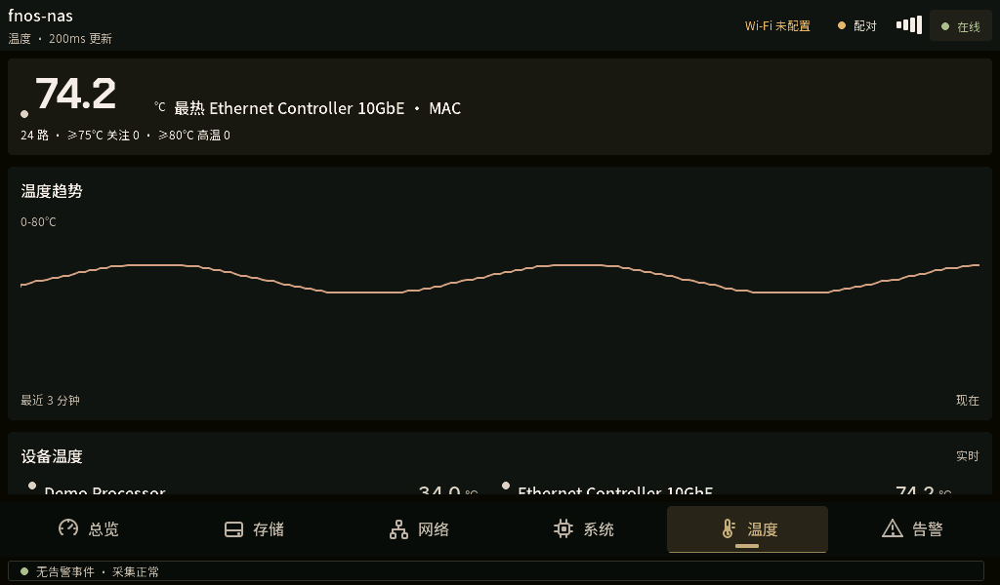

### 告警 · 先处理重要事件

严重、警告和提示分层显示，可按等级筛选。没有告警事件时，页面继续展示存储、温度、容器与采集体检。

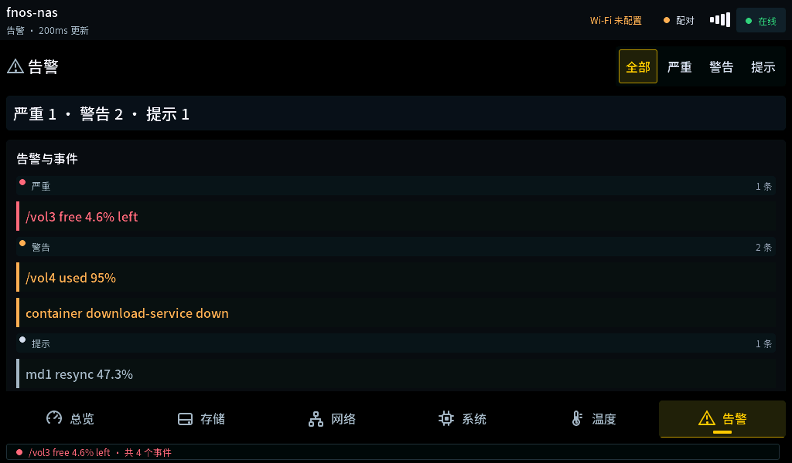

<details>
<summary><strong>无告警时的体检界面与夜间模式</strong></summary>

| 体检摘要 | 夜间模式 |
| --- | --- |
| 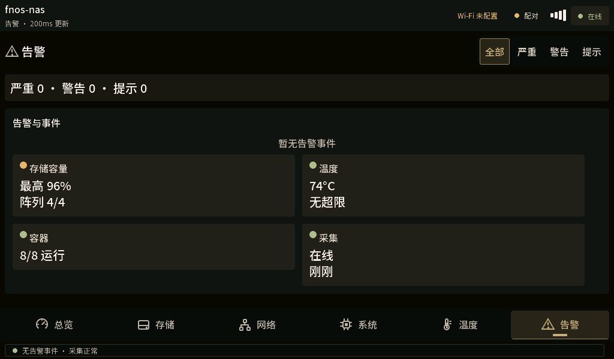 | 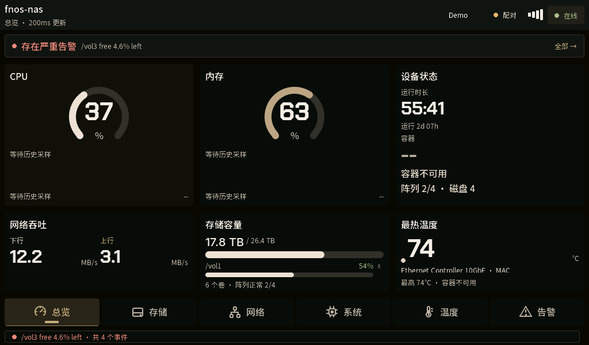 |

无告警事件不等于所有指标都正常：容量等关注项仍会独立提示。夜间背光需在真实屏幕上体验。

</details>

## 从连接到查看详情

配网、配对和诊断沿用主界面的控件语言。地址、Wi-Fi 与设备信任可在屏幕上配置。

| 选择 Wi-Fi | 输入网络口令 |
| --- | --- |
| 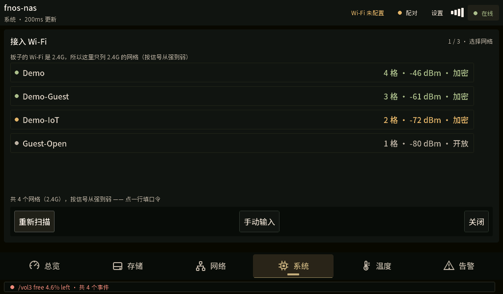 | 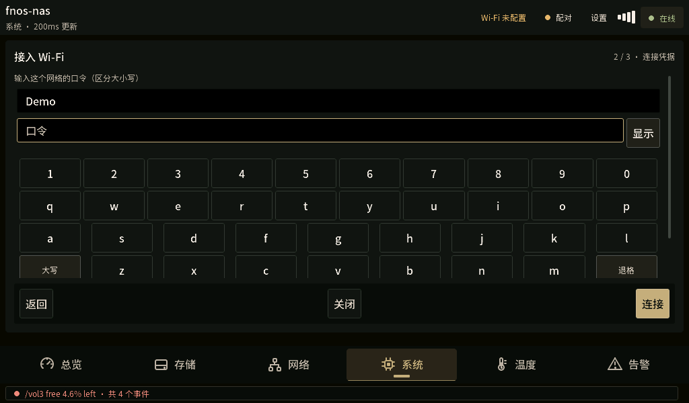 |

| 输入六位配对码 | 核对 NAS 证书指纹 |
| --- | --- |
| 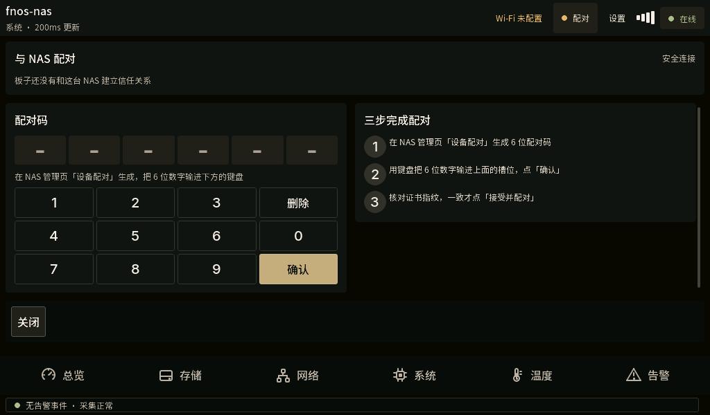 | 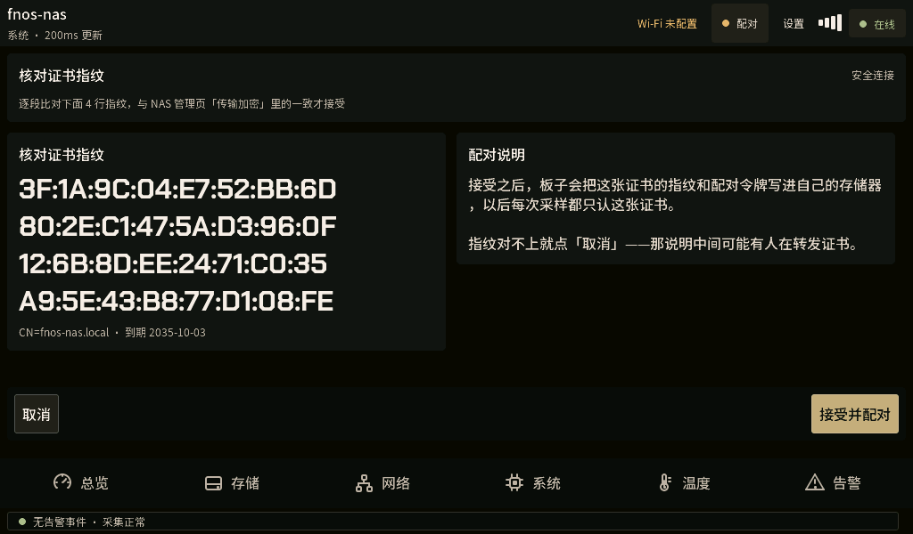 |

| 存储卷详情 | 容器详情 |
| --- | --- |
| 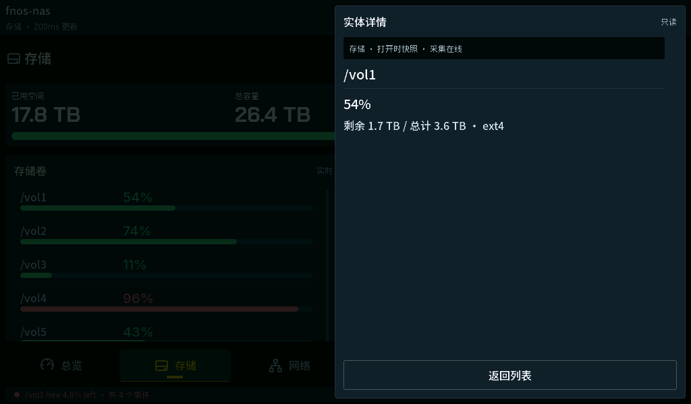 | 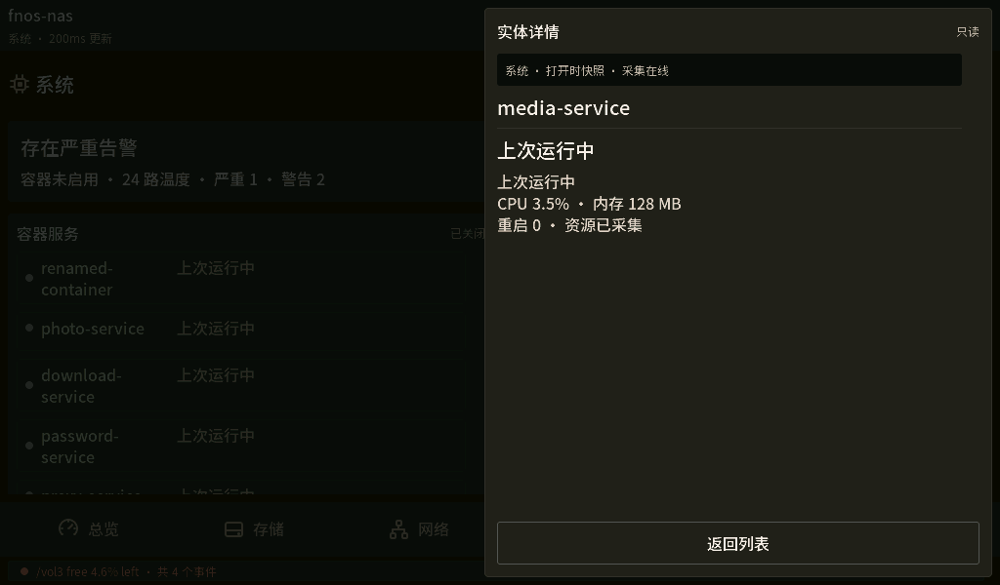 |

详情保留**打开时的快照**，方便稳定阅读。列表刷新或设备改名不会悄悄更换正在查看的对象。

<details>
<summary><strong>设置与采集诊断</strong></summary>

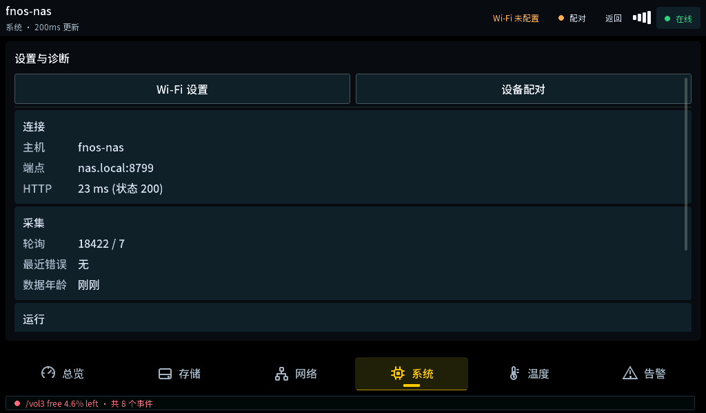

连接失败时可查看阶段、最近原因、数据年龄和来源状态；配网、配对入口集中在同一面板。

</details>

## 硬件要求

| 部分 | 当前目标 |
| --- | --- |
| 开发板 | Waveshare ESP32-P4-WIFI6-Touch-LCD-7B |
| 屏幕 / 触摸 | 7 英寸，1024×600 MIPI-DSI，EK79007 / GT911 |
| 无线连接 | 板载 ESP32-C6，通过 ESP-Hosted SDIO |
| 固件工具链 | ESP-IDF 5.5.3，目标 `esp32p4`，默认 P4 rev3.x |
| NAS 端 | fnOS、`python312`；当前配套安装包声明 `platform=x86` |
| 网络 | 开发板可访问 NAS 的 HTTPS 遥测端口，应用默认 `8798` |

当前只迭代这块开发板的横屏。设备数量、名称与清单布局按实际数据自适应；其他分辨率和竖屏不属于当前支持范围。pre-v3 与 rev3.x 固件不能互刷。

## 快速开始

### 1. 在 fnOS 安装配套应用

1. 在应用中心安装依赖 `python312`。
2. 下载 [飞牛监控 1.2.7 安装包](nas/fpk/nasscreencompanion.fpk)，通过「应用中心 → 手动安装」安装。
3. 保持默认 HTTPS 与配对令牌，确认遥测端口（默认 `8798`）。需要容器状态时启用容器采集。
4. 从飞牛桌面打开「飞牛监控」，在「能力矩阵」检查当前设备能采集哪些数据。

仓库当前安装包为 **104796 字节**，SHA-256：

```text
6feefe9dcbcfc9f4a902b3474188df1978d2693b2fd9ade2d22c84b366395f9d
```

该哈希用于核对当前下载文件；历史实机升级与性能记录有各自的产物基线，见[版本与验证边界](#最近迭代与版本边界)。安装、升级、TLS、权限与端口排障见 [飞牛应用说明](nas/fpk/README.md)。

### 2. 构建开发板固件

先激活 ESP-IDF 环境，使 `IDF_PATH`、Python 和 RISC-V 工具链可用，再执行：

```bash
git clone https://github.com/ashllll/p4-7b-fnos-monitor.git
cd p4-7b-fnos-monitor
cp components/fnos_monitor/fnos_config.example.h components/fnos_monitor/fnos_config.h
./idf.sh build
```

模板可直接构建。真实参数可保存在被忽略的 `fnos_config.h`，也可通过屏幕配置；无需把个人凭据提交到仓库。已有 `sdkconfig` 不会自动被新默认值覆盖，更新设置前先备份；依赖版本见 [dependencies.lock](dependencies.lock)。

识别开发板串口，替换示例路径后烧录：

```bash
export FNOS_SERIAL_PORT='/dev/cu.YOUR_BOARD_PORT'
./idf.sh -p "$FNOS_SERIAL_PORT" -b 230400 flash
./idf.sh -p "$FNOS_SERIAL_PORT" monitor
```

`idf.sh` 支持 `FNOS_IDF_ENV=/path/to/activation.sh ./idf.sh build`。源码与配置模板随仓库分发，个人实机固件和 NVS 留在本地。

### 3. 连 Wi-Fi 并建立设备信任

1. 在开发板 Wi-Fi 面板扫描并连接无线网络。
2. 在 NAS 管理页「设备配对」生成六位配对码。
3. 在屏幕填写 NAS 地址、应用实际遥测端口及配对码。
4. 对照 NAS 管理页，逐段核对开发板显示的证书 SHA-256 指纹，一致后接受配对。
5. 回到总览，检查数据新鲜度和各采集来源状态。

应用默认端口是 `8798`；模板中的 `8799` 为旧采集器回退值，保存后的配对端点覆盖模板。换证书需要重新确认信任，撤销设备后该设备的遥测请求被拒绝。首次明文引导只提供公开证书，不能代替指纹核对。

## 两端如何连接

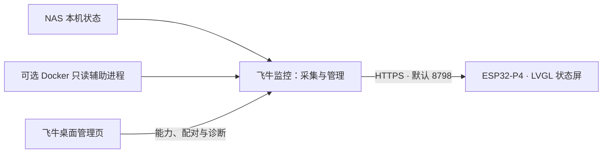

管理页通过飞牛应用网关打开，遥测端口供屏幕取数据。采集使用 Linux 本机来源；当前实现没有调用飞牛私有遥测 API。

| 数据 | 来源与条件 |
| --- | --- |
| CPU、负载、内存 | `/proc/stat`、`/proc/loadavg`、`/proc/meminfo` |
| 网络接口与速率 | `/proc/net/dev`、默认路由；各接口独立计算 |
| 存储、阵列、磁盘 IO | `/proc/mounts`、`statvfs`、`/proc/mdstat`、`/proc/diskstats` |
| 硬件温度 | `/sys/class/hwmon/*/temp*_input`；依驱动和实际可读通道 |
| 容器与资源 | 显式启用后，由受限辅助进程查询固定 Docker GET |
| 可选 SMART | `smartctl -j -H -n standby,3`；依工具、设备、权限与启用选项 |

管理服务以普通包用户运行；生命周期脚本与独立 Docker 辅助进程使用各自所需权限。磁盘和网口清单可能包含逻辑／虚拟设备，条目数量不能直接当成物理数量。字段语义见 [遥测说明](docs/ui-telemetry-2026-10-12.md)。

## 硬件自适应与资源边界

卷、阵列、磁盘、网口、容器和温度通道按实际清单分配，长名称保留，长清单可滚动。超预算或解析失败会明确报错并保留最后有效快照，避免把缺失数据当成健康零值。

<details>
<summary><strong>配置与资源预算</strong></summary>

| 配置 | 默认 | 含义 |
| --- | ---: | --- |
| `CONFIG_FNOS_STATUS_MAX_BYTES` | 262144 B | 遥测整帧字节预算 |
| `CONFIG_FNOS_SNAPSHOT_MAX_BYTES` | 1048576 B | 单份清单与字符串存储预算 |
| `CONFIG_FNOS_UI_LIST_MIN_WIDTH` | 260 px | 首选清单宽度，实际列数由空间与文本推导 |
| `CONFIG_FNOS_UI_REDUCED_MOTION` | 关闭 | 保留跟手，松手直接落定 |
| `CONFIG_FNOS_PALETTE` | `cuktech` | 另有 `unifi`、`device`、`graphite`、`abyss`、`phosphor` |

预算限制字节资源，不限定设备数量。受控 UI 分配失败有提示与重试；真实 LVGL 内存耗尽恢复仍是开放验收项。[硬件自适应记录](docs/ui-hardware-adaptive-audit-2026-10-08.md)包含清单、名称与滚动验证范围。

</details>

## 开发与验证

主机预览编译同一份 `fnos_ui.c`、`ui_kit`、生成字库及 LVGL，板级接口使用测试替身。修改后可先渲染检查布局和状态：

```bash
./idf.sh build
bash tools/preview/run.sh
python3 tools/stack_check.py
python3 tools/test_history_merge.py
```

默认预览生成 **105 张 1024×600 状态 PNG**，执行字形、格式残留、标签溢出、对象越界、触控重叠与对比度审计，并覆盖不同硬件组合和受控分配失败。数字、仪表及切页动效的独立入口见 [预览说明](tools/preview/README.md)。本页产品图的文件映射与校验值见 [图片清单](docs/images/ui-2026-10-14/manifest.json)。

固件构建和主机渲染不代替实机验收。完整物理触控、实屏动画手感、72 小时运行、掉电／旧 NVS 回退、真实内存耗尽恢复和更广泛的硬件／权限矩阵继续开放，详见 [未闭环事项](docs/open-items-2026-10-11.md)。

### 最近迭代与版本边界

- **当前界面基线 `7647d9b`**：CUKTECH 六页横屏、连续阻尼与新鲜度修复；模板构建、主机回归、静态检查、烧录哈希与短时串口观察已完成。[完整验证记录](docs/skills-workflow-2026-10-14.md)。
- **当前仓库安装包 1.2.7**：本页校验值来自当前已跟踪文件及包内 manifest；这次文档与图片更新没有重新部署 NAS，也不把历史实机记录扩展成该文件的新增验收。
- **历史 NAS 与设备证据**：[FPK 性能和 1.2.7 阶段记录](docs/fpk-performance-2026-10-12.md)、[1.2.4 发布记录](docs/release-1.2.4.md)、[架构重构](docs/architecture-refactor-2026-10-13.md)、[触控调度](docs/perf-touch-2026-10-12.md)和[交互优化](docs/perf-system-motion-2026-10-12.md)保留各自的源码、产物和验收范围。

## 常见问题

| 现象 | 检查入口 |
| --- | --- |
| 应用无法安装、启用或更新 | 应用中心日志、`python312`、平台兼容性与端口冲突；见[应用排障](nas/fpk/README.md#装不上起不来的时候) |
| 容器没有数据 | 容器采集开关、能力矩阵、Docker Socket 与辅助进程；未启用／无权限不等于零容器 |
| 开发板无法连接 NAS | NAS 地址、实际遥测端口、监听状态与网络；区分连接、TLS 和令牌错误 |
| 指纹改变或设备被撤销 | 核对当前证书，按配对流程重新授权 |
| 温度或 SMART 缺失 | 驱动、hwmon、工具与权限；缺失不等于 0°C 或健康 |
| 名称缺字、屏幕冻结或画面异常 | 字库覆盖、PSRAM、任务栈、IDF 与驱动配置；见[验证说明](docs/verification.md) |

## 文档导航

| 想做什么 | 文档 |
| --- | --- |
| 安装与维护 NAS 应用 | [飞牛应用](nas/fpk/README.md) · [可选旧采集器](nas/README.md) |
| 理解当前界面与动效 | [CUKTECH 设计](docs/ui-cuktech-2026-10-14.md) · [电流表式动效](docs/ui-ammeter-motion-2026-10-14.md) |
| 复现产品图与主机检查 | [截图来源](docs/images/ui-2026-10-14/README.md) · [预览工具](tools/preview/README.md) |
| 查看最新验证和剩余事项 | [Skills 全流程](docs/skills-workflow-2026-10-14.md) · [缺陷复核](docs/ui-post-motion-audit-2026-10-14.md) · [未闭环事项](docs/open-items-2026-10-11.md) |
| 理解源码与架构 | [固件](components/fnos_monitor/) · [共享 UI](components/fnos_monitor/ui_kit/) · [原生 UI 架构](docs/ui-v12-lvgl-native.md) · [ADR](docs/adr/README.md) |
| 配置显示与资源 | [Kconfig](components/fnos_monitor/Kconfig) · [硬件清单验证](docs/ui-hardware-adaptive-audit-2026-10-08.md) |
| 参与工程协作 | [术语表](GLOSSARY.md) · [领域约定](docs/agents/domain.md) · [任务入口](docs/agents/issue-tracker.md) |
| 回顾旧设计与发布 | [1.2.4](docs/release-1.2.4.md) · [历史 UI](docs/archive/ui/README.md) |

字体 C 文件已生成，可直接构建。改界面文案或字库后运行 `bash tools/gen_fonts.sh` 并重新预览；字体来源与可扩展字符范围见[预览说明](tools/preview/README.md#边界与坑)。

## 许可证

项目固件、采集器与飞牛应用采用 [Apache License 2.0](LICENSE)。LVGL / cJSON 为 MIT；Inter、Noto Sans SC、Chakra Petch 字体为 SIL OFL，相关许可保留在 [fonts/](components/fnos_monitor/fonts/)。
