<p align="center">
  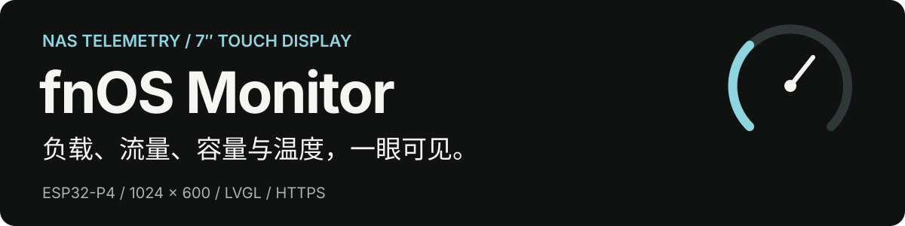
</p>

# fnOS Monitor

**飞牛 NAS 的桌面状态屏。** ESP32-P4 · 7 英寸触控 · 1024 × 600 · 原生 LVGL

[快速开始](#快速开始) · [六页界面](#界面预览) · [硬件要求](#硬件要求) · [设计总览](docs/design-overview-2026-10-14.md) · [文档导航](#文档导航)

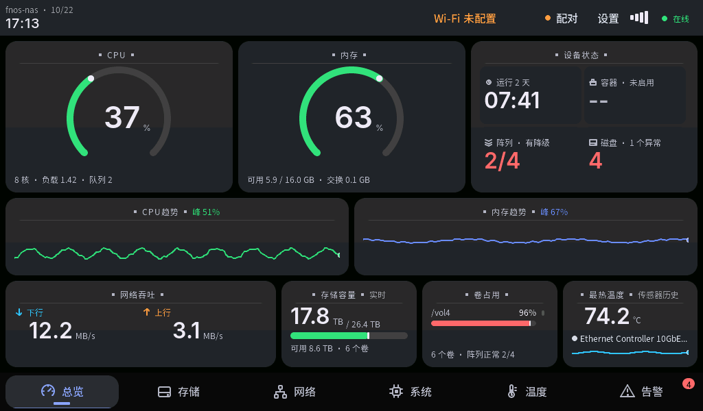

一个独立屏幕，持续呈现 NAS 的运行状态。日常看仪表、趋势和状态；需要深入时，再进入存储、网络、系统、温度与告警页面。fnOS 配套应用负责采集，开发板负责显示。

> 画面由当前源码通过真实 LVGL 在主机渲染，使用匿名夹具与合成读数；不是个人 NAS 快照或物理屏幕照片。[查看全部 15 张界面与复现说明](docs/images/ui-michka-slate-2026-10-22/README.md)。

## 一眼掌握，按需深入

- **读数与趋势**：CPU、内存、容量、流量与温度集中呈现；网速双线趋势位于网络页。
- **清单随设备变化**：卷、阵列、磁盘、网口、容器与温度通道按实际数据创建，长名称与长清单可换行、滚动查看。
- **数据状态清楚表达**：实时、旧值、无数据、权限不足与离线分别提示；保留真实零值，缺失不会伪装成健康。
- **屏幕完成配置**：Wi-Fi、HTTPS 配对与证书指纹核对无需写入 NAS 管理员密码；详情保留打开时的快照。

底部导航直达六页，横向拖动以原生裁剪揭示下一页，内容保持原位、边界跟随手指；清单纵向滚动，且总是停在整行上。当前默认 `michka` 主题复刻 [michka](https://michka.org/) 的 slate sensor-panel 皮肤：近黑画布、灰色气泡卡片、居中的方块帽标题、Inter 数字；夜间模式及显示参数可配置。

## 硬件要求

| 部分 | 当前目标 |
| --- | --- |
| 开发板 | Waveshare ESP32-P4-WIFI6-Touch-LCD-7B |
| 屏幕 / 触摸 | 7 英寸，1024×600 MIPI-DSI，EK79007 / GT911 |
| 无线连接 | 板载 ESP32-C6，通过 ESP-Hosted SDIO |
| 固件工具链 | ESP-IDF 5.5.5，LVGL 9.6.0 / adapter 0.7.3，目标 `esp32p4`，默认 P4 rev3.x |
| NAS 端 | fnOS、`python312`；当前配套安装包声明 `platform=x86` |
| 网络 | 开发板可访问 NAS 的 HTTPS 遥测端口，应用默认 `8798` |

当前只迭代这块开发板的横屏。设备数量、名称与清单布局按实际数据自适应；其他分辨率和竖屏不属于当前支持范围。pre-v3 与 rev3.x 固件不能互刷。

## 快速开始

### 首次使用流程

以下按默认 HTTPS 模式展示。先准备 NAS 应用和开发板，再在屏幕上完成配对；证书指纹需要人工对照 NAS 管理页。

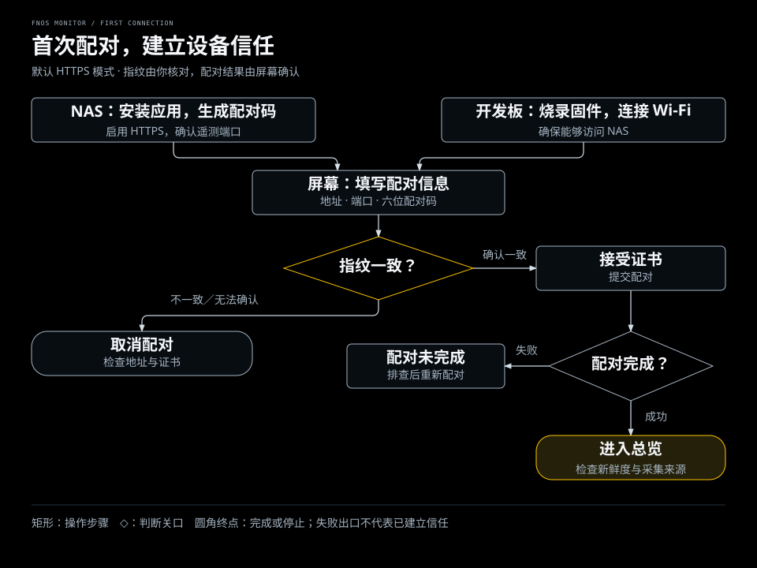

配对码过期时在管理页重新生成；网络、证书或保存失败时按屏幕提示处理。只有显示「配对完成」后才进入日常监控。

### 1. 在 fnOS 安装配套应用

1. 在应用中心安装依赖 `python312`。
2. 下载 [飞牛监控 1.2.7 安装包](nas/fpk/nasscreencompanion.fpk)，通过「应用中心 → 手动安装」安装。
3. 保持默认 HTTPS 与配对令牌，确认遥测端口（默认 `8798`）。需要容器状态时启用容器采集。
4. 从飞牛桌面打开「飞牛监控」，在「能力矩阵」检查当前设备能采集哪些数据。

仓库当前安装包为 **104796 字节**，SHA-256：

```text
6feefe9dcbcfc9f4a902b3474188df1978d2693b2fd9ade2d22c84b366395f9d
```

该哈希用于核对当前下载文件；历史实机升级与性能记录有各自的产物基线，见[版本与验证边界](#最近迭代与版本边界)。安装、升级、TLS、权限与端口排障见 [飞牛应用说明](nas/fpk/README.md)。

### 2. 构建开发板固件

先激活 ESP-IDF 5.5.5 环境及其配套工具链，使 `IDF_PATH`、Python 和 RISC-V 编译器可用，再执行：

```bash
git clone https://github.com/ashllll/p4-7b-fnos-monitor.git
cd p4-7b-fnos-monitor
cp components/fnos_monitor/fnos_config.example.h components/fnos_monitor/fnos_config.h
./idf.sh build
```

模板可直接构建。真实参数可保存在被忽略的 `fnos_config.h`，也可通过屏幕配置；无需把个人凭据提交到仓库。已有 `sdkconfig` 不会自动被新默认值覆盖；当前 `sdkconfig.defaults` 默认主题为 `michka`。从旧配置升级并切换到当前主题时，在 menuconfig 的 fnOS monitor 主题项选择 `michka`，更新设置前先备份；依赖版本见 [dependencies.lock](dependencies.lock)。

识别开发板串口，替换示例路径后烧录：

```bash
export FNOS_SERIAL_PORT='/dev/cu.YOUR_BOARD_PORT'
./idf.sh -p "$FNOS_SERIAL_PORT" -b 230400 flash
./idf.sh -p "$FNOS_SERIAL_PORT" monitor
```

`idf.sh` 支持 `FNOS_IDF_ENV=/path/to/activation.sh ./idf.sh build`。源码与配置模板随仓库分发，个人实机固件和 NVS 留在本地。

联网后可在串口输入 `wifi version`，通过官方 RPC 只读查询板上无线协处理器的固件版本。它与 `dependencies.lock` 中的主机 ESP-Hosted 依赖版本分别记录；离线或查询失败会提示原因，不执行协处理器升级。

### 3. 连 Wi-Fi 并建立设备信任

1. 在开发板 Wi-Fi 面板扫描并连接无线网络。
2. 在 NAS 管理页「设备配对」生成六位配对码。
3. 在屏幕填写 NAS 地址、应用实际遥测端口及配对码。
4. 对照 NAS 管理页，逐段核对开发板显示的证书 SHA-256 指纹，一致后接受配对。
5. 回到总览，检查数据新鲜度和各采集来源状态。

应用默认端口是 `8798`；模板中的 `8799` 为旧采集器回退值，保存后的配对端点覆盖模板。换证书需要重新确认信任，撤销设备后该设备的遥测请求被拒绝。首次明文引导只提供公开证书，不能代替指纹核对。

## 界面预览

总览主图展示日常最常看的指标。其余页面各自回答一个问题：

| 页面 | 关注什么 |
| --- | --- |
| 存储 | 容量还够吗？卷、阵列、磁盘的健康与读写如何？ |
| 网络 | 当前收发多快？近期吞吐是否波动？各接口是否在线？ |
| 系统 | 容器是否运行？系统摘要与硬件状态如何？ |
| 温度 | 哪个设备最热？展开设备查看完整温度通道。 |
| 告警 | 哪些事件需要先处理？无告警时继续查看采集体检。 |

### 存储：容量与阵列健康

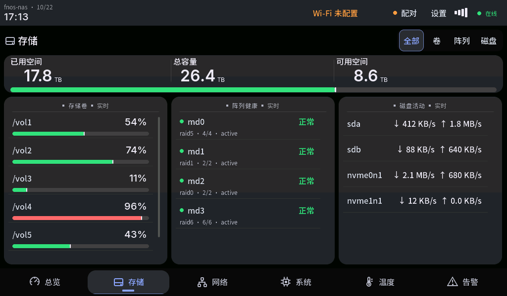

<details>
<summary><strong>展开网络、系统、温度与告警界面</strong></summary>

### 网络：收发速率、双线趋势与接口状态

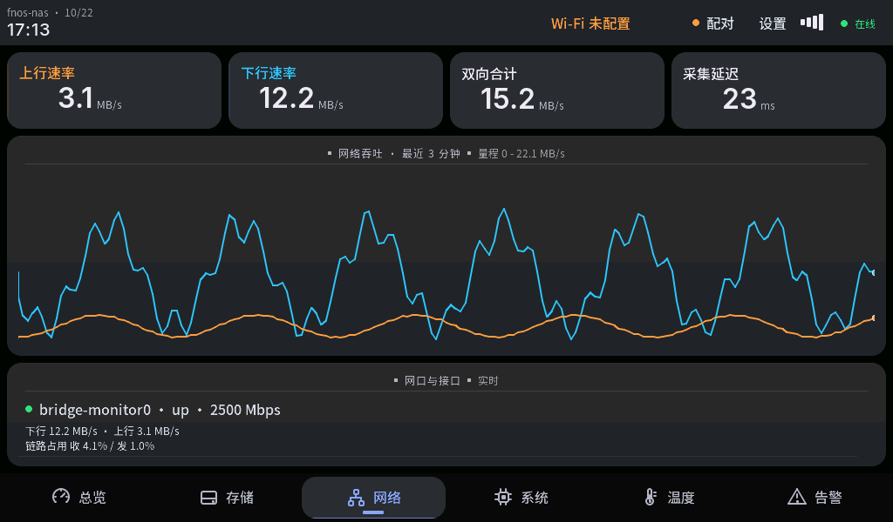

### 系统：容器、硬件温度与摘要

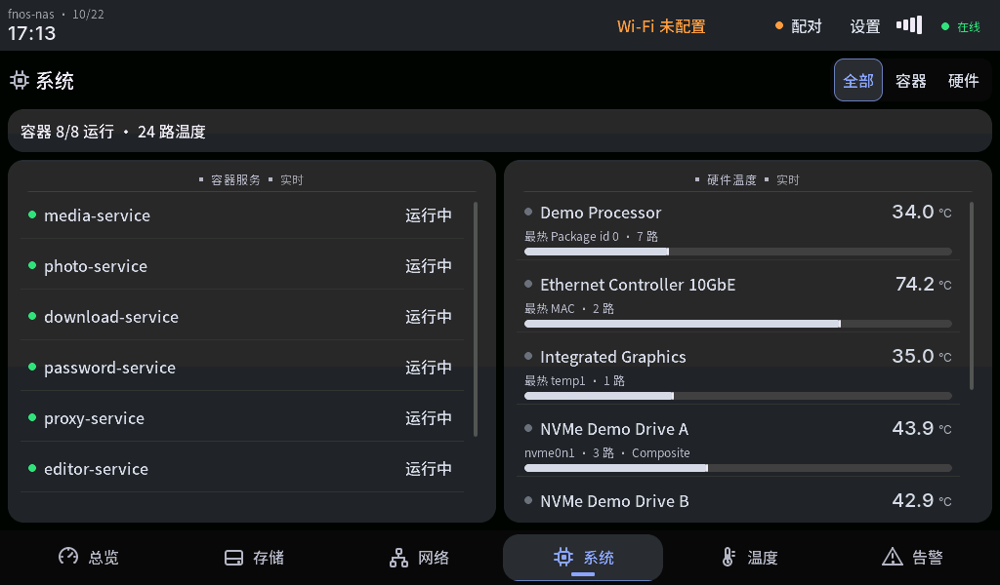

### 温度：最高温、趋势与设备通道

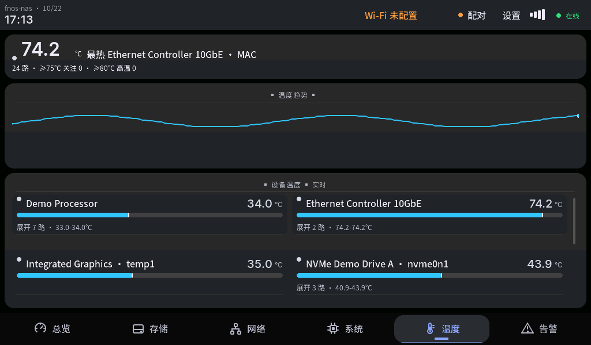

### 告警：按严重程度筛选事件


</details>

<details>
<summary><strong>展开配网、配对、详情与夜间模式</strong></summary>

### 从连接到查看详情

配网、配对和诊断沿用主界面的控件语言。地址、Wi-Fi 与设备信任可在屏幕上配置。

| 选择 Wi-Fi | 输入网络口令 |
| --- | --- |
| 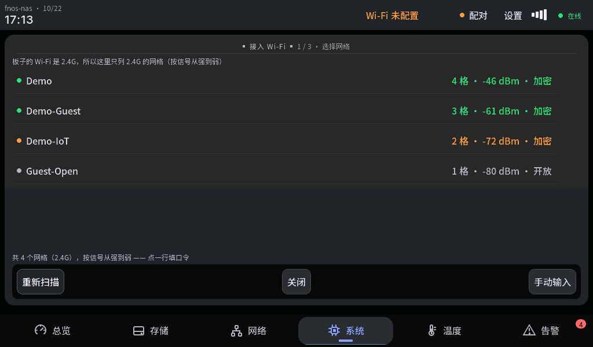 | 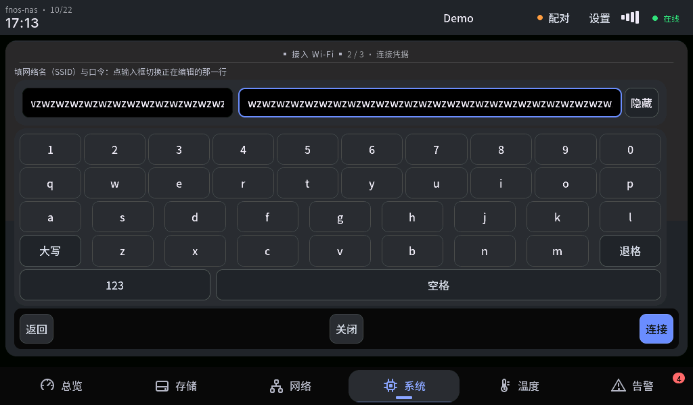 |

| 输入六位配对码 | 核对 NAS 证书指纹 |
| --- | --- |
| 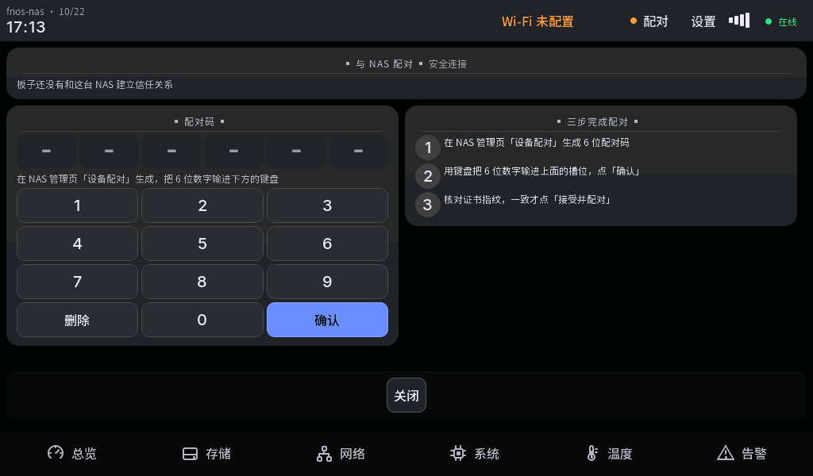 | 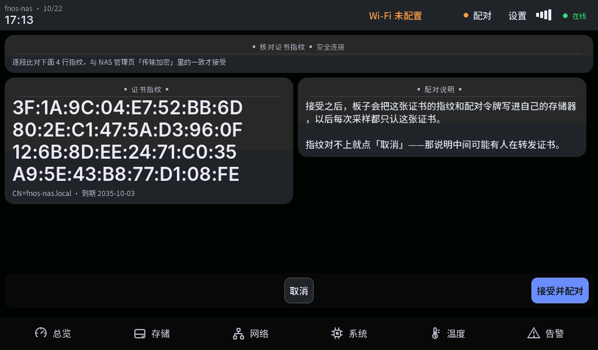 |

| 存储卷详情 | 容器详情 |
| --- | --- |
| 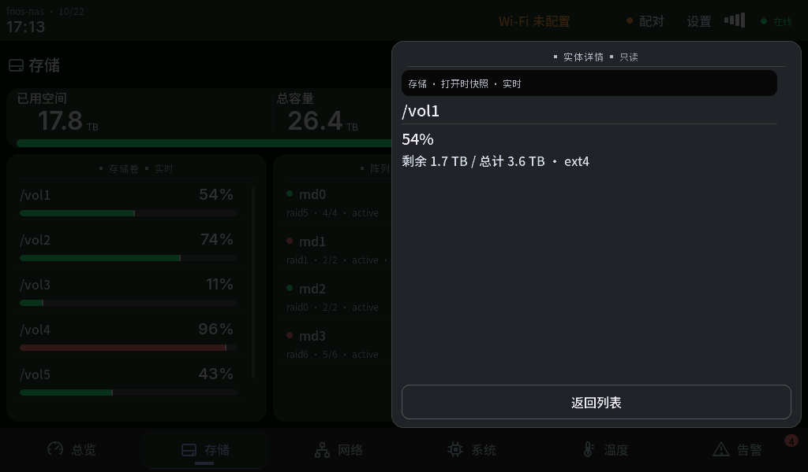 | 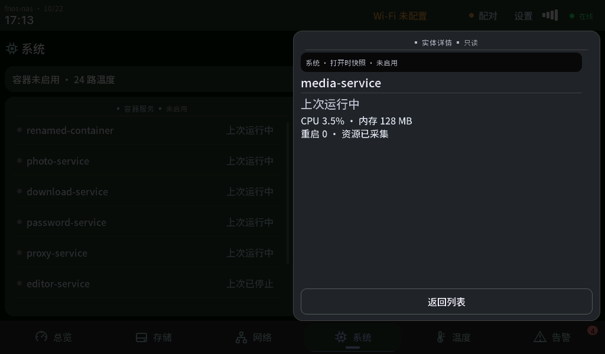 |

详情保留**打开时的快照**，方便稳定阅读。列表刷新或设备改名不会悄悄更换正在查看的对象。

<details>
<summary><strong>设置与采集诊断</strong></summary>

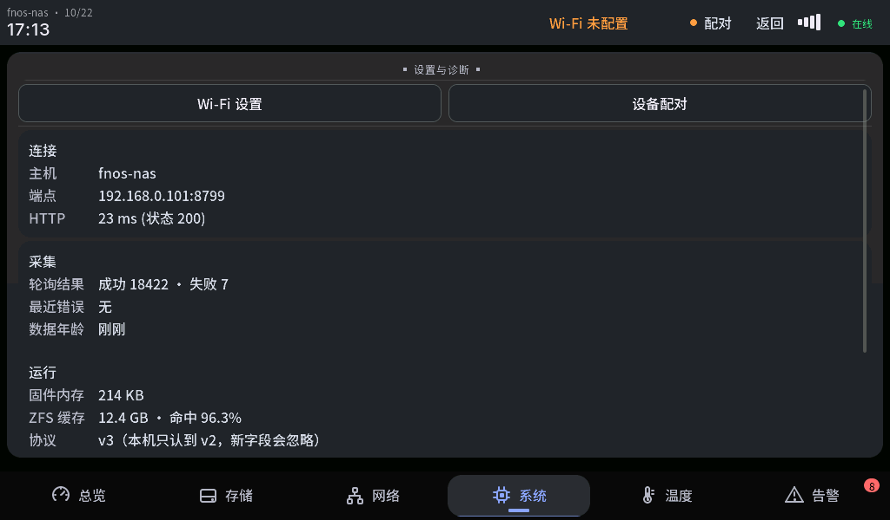

连接失败时可查看阶段、最近原因、数据年龄和来源状态；配网、配对入口集中在同一面板。

</details>

| 体检摘要 | 夜间模式 |
| --- | --- |
| 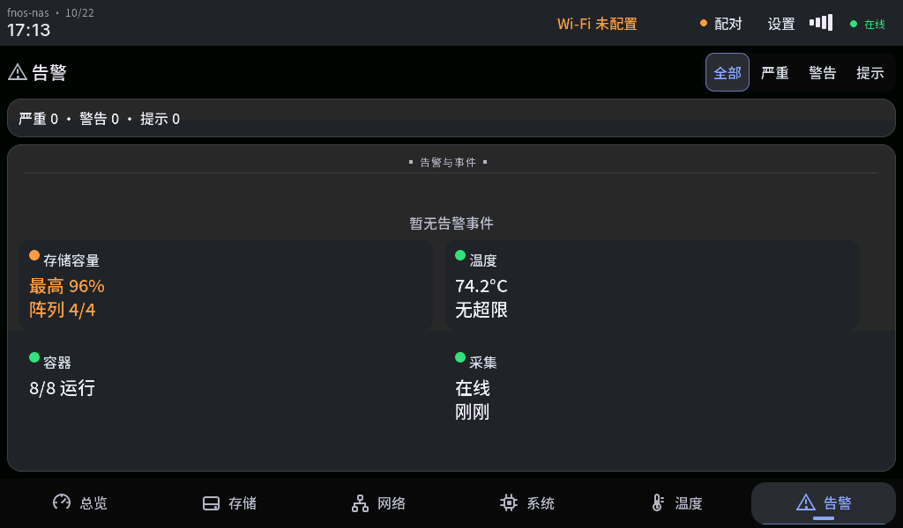 | 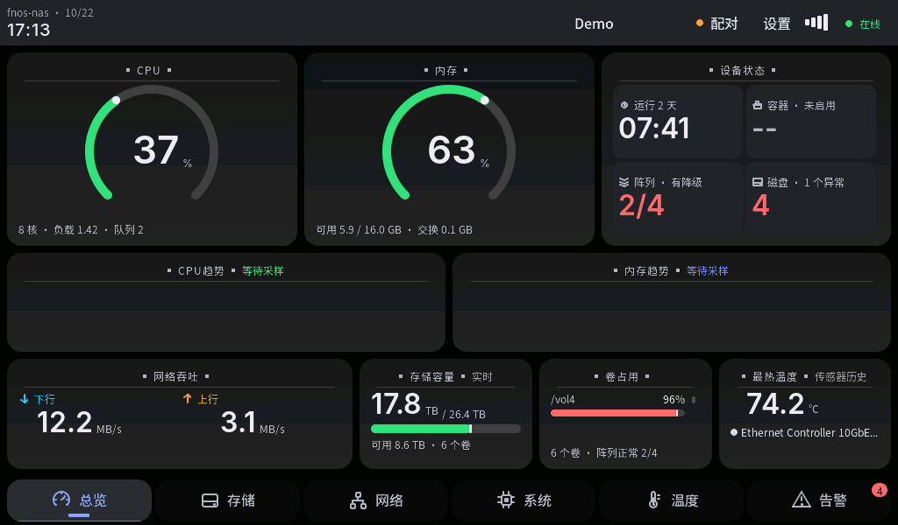 |

无告警事件不等于所有指标都正常；夜间背光需在真实屏幕上体验。

</details>

## 两端如何连接

### 日常数据流

箭头表示数据或请求的方向。屏幕主动拉取遥测；虚线区分可选容器数据与遥测响应。

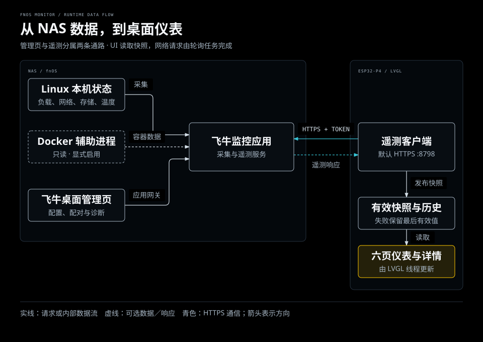

两张图使用 `diagram-design` 重绘，沿用本项目黑底蓝青仪表视觉；[可编辑源文件与导出说明](docs/diagrams/README.md)随仓库保留。

管理页通过飞牛应用网关打开，遥测端口供屏幕取数据。网络请求在轮询任务执行，UI 只读取内存快照；请求或解析失败保留最后有效数据，并提示连接／新鲜度状态。采集使用 Linux 本机来源；当前实现没有调用飞牛私有遥测 API。

| 数据 | 来源与条件 |
| --- | --- |
| CPU、负载、内存 | `/proc/stat`、`/proc/loadavg`、`/proc/meminfo` |
| 网络接口与速率 | `/proc/net/dev`、默认路由；各接口独立计算 |
| 存储、阵列、磁盘 IO | `/proc/mounts`、`statvfs`、`/proc/mdstat`、`/proc/diskstats` |
| 硬件温度 | `/sys/class/hwmon/*/temp*_input`；依驱动和实际可读通道 |
| 容器与资源 | 显式启用后，由受限辅助进程查询固定 Docker GET |
| 可选 SMART | `smartctl -j -H -n standby,3`；依工具、设备、权限与启用选项 |

管理服务以普通包用户运行；生命周期脚本与独立 Docker 辅助进程使用各自所需权限。磁盘和网口清单可能包含逻辑／虚拟设备，条目数量不能直接当成物理数量。字段语义见 [遥测说明](docs/ui-telemetry-2026-10-12.md)。

## 硬件自适应与资源边界

卷、阵列、磁盘、网口、容器和温度通道按实际清单分配，长名称保留，长清单可滚动。超预算或解析失败会明确报错并保留最后有效快照，避免把缺失数据当成健康零值。

<details>
<summary><strong>配置与资源预算</strong></summary>

| 配置 | 默认 | 含义 |
| --- | ---: | --- |
| `CONFIG_FNOS_STATUS_MAX_BYTES` | 262144 B | 遥测整帧字节预算 |
| `CONFIG_FNOS_SNAPSHOT_MAX_BYTES` | 1048576 B | 单份清单与字符串存储预算 |
| `CONFIG_FNOS_UI_LIST_MIN_WIDTH` | 260 px | 首选清单宽度，实际列数由空间与文本推导 |
| `CONFIG_FNOS_UI_REDUCED_MOTION` | 关闭 | 保留跟手，松手直接落定 |
| `CONFIG_FNOS_PALETTE` | `michka` | 当前 slate sensor-panel 主题；历史主题仍可选择 |

预算限制字节资源，不限定设备数量。受控 UI 分配失败有提示与重试；真实 LVGL 内存耗尽恢复仍是开放验收项。[硬件自适应记录](docs/ui-hardware-adaptive-audit-2026-10-08.md)包含清单、名称与滚动验证范围。

</details>

## 开发与验证

主机预览编译同一份 `fnos_ui.c`、`ui_kit`、生成字库及 LVGL，板级接口使用测试替身。修改后可先渲染检查布局和状态：

```bash
./idf.sh build
bash tools/preview/run.sh
python3 tools/stack_check.py
python3 tools/test_history_merge.py
```

2026-10-23 的完整预览记录生成 **131 张 1024×600 状态 PNG + 10 张刷新／对齐回归 PNG**，并执行字形、格式残留、标签溢出、对象越界、触控重叠与对比度审计，覆盖不同硬件组合和受控分配失败。这个数量对应 [当日验证记录](docs/ui-validation-2026-10-23.md)，不是未来运行固定不变的样本总数。数字、仪表及切页动效的独立入口见 [预览说明](tools/preview/README.md)。本页产品图的文件映射与校验值见 [图片清单](docs/images/ui-michka-slate-2026-10-22/manifest.json)。

固件构建和主机渲染不代替实机验收。[2026-10-24 裁剪揭示对照](docs/ui-drag-lvgl96-2026-10-24.md)中，三页在线拖动 P50 帧间隔从约 38–48 ms 降到约 16.56 ms，接近面板 60 Hz；P95 仍约 28–37 ms，未达到全程锁定 60 FPS。实拍仍受斜拍与局部遮挡限制，完整触控验收仍开放。此前结果见 [2026-10-23 验证记录](docs/ui-validation-2026-10-23.md)。当前实施待办集中见[待办与验收缺口](docs/todo-implementation-2026-10-23.md)；72 小时运行、掉电／旧 NVS 回退、真实内存耗尽恢复和更广泛的硬件／权限矩阵仍开放。

<details>
<summary><strong>最近迭代与版本边界</strong></summary>

### 最近迭代与版本边界

- **此前已发布基线 `b64be21`（2026-10-23）**：完成圆环与同行单位对齐、Wi-Fi 恢复及网络清单布局缓存，源码已发布。在线拖动实测仍约 20–26 FPS；手势、整屏实拍、长期运行与故障恢复边界见[验证记录](docs/ui-validation-2026-10-23.md)和[当前待办](docs/todo-implementation-2026-10-23.md)。
- **当前 michka 石板灰界面（2026-10-22）**：六页共用一套 slate sensor-panel 皮肤——近黑画布、灰色渐变气泡卡片、居中方块帽标题、Inter 数字、顶栏日期与大号时钟；清单统一行高，卡底只停在整行；图表去掉刻度只留卡头量程。README 同步 15 张匿名产品图。[设计与验证](docs/ui-michka-slate-2026-10-22.md) · [历史 ULTRA 记录](docs/ui-ultra-release-2026-10-14.md)。

- **前一阶段界面基线 `7647d9b`**：CUKTECH 六页横屏、连续阻尼与新鲜度修复；模板构建、主机回归、静态检查、烧录哈希与短时串口观察已完成。[完整验证记录](docs/skills-workflow-2026-10-14.md)。
- **当前仓库安装包 1.2.7**：本页校验值来自当前已跟踪文件及包内 manifest；这次文档与图片更新没有重新部署 NAS，也不把历史实机记录扩展成该文件的新增验收。
- **历史 NAS 与设备证据**：[FPK 性能和 1.2.7 阶段记录](docs/fpk-performance-2026-10-12.md)、[1.2.4 发布记录](docs/release-1.2.4.md)、[架构重构](docs/architecture-refactor-2026-10-13.md)、[触控调度](docs/perf-touch-2026-10-12.md)和[交互优化](docs/perf-system-motion-2026-10-12.md)保留各自的源码、产物和验收范围。

</details>

## 常见问题

| 现象 | 检查入口 |
| --- | --- |
| 应用无法安装、启用或更新 | 应用中心日志、`python312`、平台兼容性与端口冲突；见[应用排障](nas/fpk/README.md#装不上起不来的时候) |
| 容器没有数据 | 容器采集开关、能力矩阵、Docker Socket 与辅助进程；未启用／无权限不等于零容器 |
| 开发板无法连接 NAS | NAS 地址、实际遥测端口、监听状态与网络；区分连接、TLS 和令牌错误 |
| 指纹改变或设备被撤销 | 核对当前证书，按配对流程重新授权 |
| 温度或 SMART 缺失 | 驱动、hwmon、工具与权限；缺失不等于 0°C 或健康 |
| 名称缺字、屏幕冻结或画面异常 | 字库覆盖、PSRAM、任务栈、IDF 与驱动配置；见[验证说明](docs/verification.md) |

## 文档导航

| 想做什么 | 文档 |
| --- | --- |
| 全面理解产品、界面与工程设计 | [设计总览：页面、视觉、动效、数据、架构与验收](docs/design-overview-2026-10-14.md) |
| 安装与维护 NAS 应用 | [飞牛应用](nas/fpk/README.md) · [可选旧采集器](nas/README.md) |
| 理解当前界面与动效 | [michka 石板灰](docs/ui-michka-slate-2026-10-22.md) · [ULTRA 配色（历史）](docs/ui-cuktech-ultra-2026-10-14.md) · [页面合同](docs/ui-cuktech-2026-10-14.md) · [电流表式动效](docs/ui-ammeter-motion-2026-10-14.md) |
| 复现产品图与主机检查 | [截图来源](docs/images/ui-michka-slate-2026-10-22/README.md) · [预览工具](tools/preview/README.md) |
| 查看最新验证和剩余事项 | [本轮待办实施验收](docs/ui-todo-validation-2026-10-23.md) · [此前已发布的 UI 验证](docs/ui-validation-2026-10-23.md) · [当前待办](docs/todo-implementation-2026-10-23.md) · [历史审计矩阵](docs/open-items-2026-10-11.md) · [早期发布与缺陷记录](docs/ui-ultra-release-2026-10-14.md) · [历史 Skills 全流程](docs/skills-workflow-2026-10-14.md) |
| 理解源码与架构 | [固件](components/fnos_monitor/) · [共享 UI](components/fnos_monitor/ui_kit/) · [原生 UI 架构](docs/ui-v12-lvgl-native.md) · [ADR](docs/adr/README.md) |
| 配置显示与资源 | [Kconfig](components/fnos_monitor/Kconfig) · [硬件清单验证](docs/ui-hardware-adaptive-audit-2026-10-08.md) |
| 参与工程协作 | [术语表](GLOSSARY.md) · [领域约定](docs/agents/domain.md) · [任务入口](docs/agents/issue-tracker.md) |
| 回顾旧设计与发布 | [1.2.4](docs/release-1.2.4.md) · [历史 UI](docs/archive/ui/README.md) |

字体 C 文件已生成，可直接构建。改界面文案或字库后运行 `bash tools/gen_fonts.sh` 并重新预览；字体来源与可扩展字符范围见[预览说明](tools/preview/README.md#边界与坑)。

## 许可证

项目固件、采集器与飞牛应用采用 [Apache License 2.0](LICENSE)。LVGL / cJSON 为 MIT；Inter、Noto Sans SC、Chakra Petch 字体为 SIL OFL，相关许可保留在 [fonts/](components/fnos_monitor/fonts/)。

主机状态图标由 Michka 图形派生，单独采用 **CC BY-NC 4.0**；来源、署名与修改说明见[图标目录](components/fnos_monitor/assets/michka_host_status/README.md)及其[许可证](components/fnos_monitor/assets/michka_host_status/LICENSE)。包含这些图标的发行物须保留署名并遵守该非商业许可。
