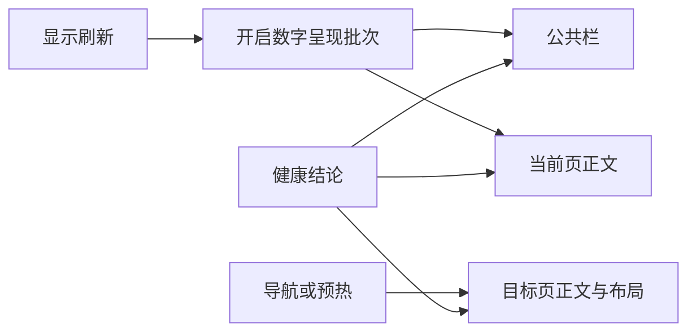

# 健康结论、页面刷新与 Docker 指标重构

本轮以发布目录 `main` 的 `d282c6a` 为基线，按架构评估顺序完成三个有界重构。实现使用 `codebase-design`、`ponytail`，界面沿用 `unifi-ui-design` 的现有原生 LVGL 方向；既有代码修改前阅读完整目标逻辑及调用方。本轮未进行 NAS 部署、烧录或复位；源码提交与推送不代表设备验收通过。

## 健康结论集中计算

`fnos_ui.c` 的内部 `health_summary` 从当前采集快照一次计算事件分组计数、最高严重度事件、运行容器数与健康结论。首页、底栏、系统摘要和告警页复用该结果。严重优先于警告、警告优先于提示，同级保持原始顺序；未知等级按提示处理。

此前底栏选择最高严重度，首页却直接显示首条事件。新增回归先在旧实现上失败，再在重构后通过，并分别验证首页和底栏。首次采集、离线旧值、采集段状态及“无采集告警”的语义继续保留；没有告警不升级成所有读数已确认健康。结果只借用当前快照，不保留事件字符串或新增清单副本。

## 页面正文与公共栏分别刷新



`refresh_shell` 处理公共栏，`refresh_body` 接收明确的目标页，删除 `s_force_page` 和 `page_on` 的隐式目标状态。`refresh_page` 不再重入完整刷新，也不重开全局数字批次；目标页准备期间直接显示当前快照的数值，随后恢复数字动效开关。显示刷新继续管理其他页面的 dirty 状态，拖动期间的数据及历史消费路径未改变。

内存失败提示仍可由页面准备路径写入公共底栏，这是“仅刷新正文”的刻意例外：分配失败必须可见，不能以职责整理为由隐藏错误。

窄屏复验还发现底栏长事件默认换行后超过单行容器。现按字体行高固定为一行省略，点击底栏仍能查看完整事件；未新增屏幕尺寸或设备数量限制。

## Docker 指标的一份规范源码

轮转、CPU 差值、内存扣减、缓存淘汰及失效时间戳统一维护在 `nas/docker_metrics.py.inc`。`DockerMetrics` 拥有实例状态，接收读取函数及可选时钟；旧代理的每个 `Collector` 单独拥有指标实例。直接读取与 root 辅助进程分别保留自己的运行实例。

采用构建时内联而不是新增运行时导入：root 入口继续只执行受信任 `cmd` 中的代码，旧代理继续按现有单文件方式安装。HTTP GET 白名单、ID 校验、响应预算、IPC 帧限制、fork 和永久降权路径保持原样。

修改规范源码后运行：

```bash
python3 nas/sync_docker_metrics.py --write
python3 nas/sync_docker_metrics.py
python3 nas/fpk/test_metrics.py
```

同步脚本仅替换带标记的生成区段，保留入口其他代码。`nas/fpk/build.sh` 在打包前检查三个副本一致性，发现漂移即失败；默认检查不写文件。测试覆盖副本漂移、同步恢复、标记缺失与打包拒绝。`contract_check.py` 同步跟踪新的指标构造方法。

## 本轮实际验证

| 检查 | 结果与范围 |
| --- | --- |
| ESP-IDF 5.5.3 / ESP32-P4 构建 | 通过，无编译警告；复用已记录的目标和环境，不重新设置芯片 |
| 当前 ELF 静态栈检查 | 7 个任务入口通过；LVGL 下界 4800 / 12288 B，轮询 4560 / 6144 B；仍不证明所有动态调用与中断嵌套 |
| 目标 GCC `-fanalyzer` | `fnos_ui.c` 使用实际编译参数通过；通用助手把 Apple clang 误识别为 GCC，采用实际 RISC-V GCC 验证 |
| 原生 LVGL 主机预览 | 1024×600 完整 101 帧、稳定刷新、快照所有权、空/少量/混合/密集清单及分配失败恢复通过 |
| 窄屏完整状态 | 480×480、800×480 通过；查看实际 PNG，包含单行底栏与完整事件入口 |
| 导航与数字呈现 | 原生滑动 140 帧、重复目标 96 帧、首次系统页 71 帧及数字自检通过；主机取样步长不代表设备帧率 |
| Docker 指标与生成副本 | `test_metrics.py` 4 项通过，覆盖三个部署入口、隔离、移除/恢复、失败及漂移；`docker_check.py` 的 Unix HTTP / fork / IPC 集成通过 |
| 打包故障门 | `test_validation_gates.py` 42 项通过，含副本漂移拒绝打包及原有坏包/工具失败检查 |
| 既有相关回归 | 服务安全 67 项、启动权限 10 项、遥测发布 14 项、SSH/旧代理安装 11 项通过；UI 请求/定时器自检及负控通过 |
| 本地 FPK 构建 | 构建和 manifest 检查通过；回读外层 `cmd/docker_launch.py` 与内层 `server/docker_api.py` 的生成代码；布局原文核对因历史临时资料不存在而跳过 |
| 独立代码复查 | 标准与需求两个只读复查均无确认缺陷；后续实例归属、底栏及夹具修改另行复查 |

构建助手首次探测时没有已激活的 IDF 环境；按本工程已记录的 ESP-IDF 路径、Python 与工具链使用 `idf.sh` 完成构建。通用 map 助手不正确汇总 ESP32 section 的 RAM 数值，因此不以它的百分比作为内存验收依据。

主机图像保留在忽略目录 `tools/preview/out-architecture-final-20261013/`，窄屏样张和测试日志仅保存在本机临时目录。测试构建的 FPK 留在 `/tmp/fnos-architecture-20261013-verified.fpk`，仓库中原有 FPK 未更新。本轮构建、主机渲染和模拟检查不等于物理触摸、面板表现、真实 NAS 升级或长期运行验收。
