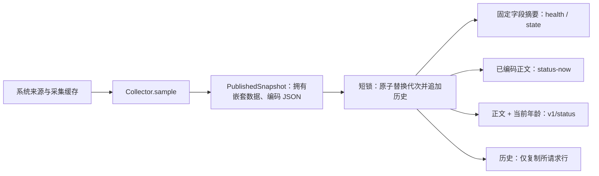

# FPK 1.2.6 / 1.2.7：遥测发布与连接寿命

本轮候选将完整快照的复制和 JSON 编码集中到采样发布阶段。健康与管理摘要只读取固定字段；多个读取者共享同一代已编码数据，HTTP 请求只追加当前数据年龄与应用版本。完整硬件清单仍按实际数量返回。

本轮改动尚未提交或推送。已通过真实 fnOS 应用中心将 1.2.4 升级为 1.2.6，再升级为 1.2.7；安装身份、配置保留和针对性运行结果见下文。主机性能数字不能证明整机 30% 性能目标或 72 小时稳定性。

## 模块与所有权



`telemetry_snapshot.py` 集中处理快照所有权、序列化及请求元数据。采样器可能复用嵌套缓存，因此发布前仍需拥有一份数据；借用的 `data` 只供采样器只读使用，HTTP 层取得不可变字节。编码与复制在锁外完成，锁内仅交换引用和更新有界历史；正在读取旧代的请求仍持有完整旧代，不会混入下一代设备行。

`Collector` 提供 `read_snapshot`、`read_summary` 和 `read_history`。摘要不遍历设备清单；历史请求 `n>0` 只复制最近 n 行。停止事件在同一发布锁下设置，采样或编码晚返回时不能越过停止屏障发布成功或失败代次。采样间隔使用单调时钟，系统时间回拨不会导致异常长等待；对外时间戳仍为 Unix 时间。

原五列历史顺序保留，末尾追加 `temp_max`；缺失或陈旧温度为 `null`。旧固件读取原五列并忽略额外列，当前固件可读取最高温。生命周期断言此前仍要求恰好五列，本轮已对齐六列，并验证非法列名、顺序、行宽、布尔值、非有限数及错误温度类型均被拒绝。

## 对比测量

Python 3.12.15，同一主机，匿名卷、容器、温度各 32 / 256 / 1024 项；比较 `8cca07c` 原始服务与**实际候选 FPK 解包代码**。每条路由预热后取 7 批、每批 40 次的中位数。两端元数据和响应字节数一致。数值仅包含主机生产路由、复制与编码，不包含采集来源、网络传输或 NAS 实机耗时。

匿名测量结果：[原版](benchmarks/fpk-1.2.6/baseline.json)、[实际候选包](benchmarks/fpk-1.2.6/candidate.json)，包含源码/包身份及测量参数。

| 每类实体数 | health 原版 → 候选 µs | status 原版 → 候选 µs | 发布 + 4 次 status 原版 → 候选 µs |
| ---: | ---: | ---: | ---: |
| 32 | 203.06 → 3.61 | 259.96 → 3.44 | 1045.06 → 295.64 |
| 256 | 1564.95 → 3.57 | 2022.36 → 4.82 | 8112.49 → 2149.93 |
| 1024 | 6145.69 → 3.35 | 8028.34 → 9.01 | 32200.42 → 8512.20 |

1024 项时，管理摘要约 6102 → 11.93 µs，原始状态正文约 8331 → 0.41 µs。原始正文的读数只计取得缓存字节，后续网络写入仍随正文大小增长。

成本没有消失：完整发布由约 87 → 8476 µs。每代仅一个 status 读取者时，发布与读取合计 8115 → 8485 µs，约增加 4.6%；每代四个读取者时下降约 73.6%，32 个时下降约 96.6%。没有读取者时仍支付编码成本。此取舍使请求与停止锁更短，但不能据此声称整台 NAS 性能提升 30%。

1024 项正文为 321443 字节，超过固件默认 262144 字节接收预算。这是后端压力样本，不代表默认屏端能接收该规模；需按实际负载配置字节预算，超预算应明确拒绝，不能截断清单。

复现：

```bash
python3.12 nas/fpk/benchmark_telemetry.py
# 在独立进程比较保存的旧版本或实际解包目录：
python3.12 nas/fpk/benchmark_telemetry.py --server-dir /path/to/server
python3.12 nas/fpk/test_telemetry_publication.py
python3 tools/test_http_connection.py
FNOS_TEST_SERVER_DIR=/path/to/server python3.12 nas/fpk/test_telemetry_publication.py
python3.12 nas/fpk/mem_check.py 3000 --entities 1024 --publish-every 10 --server-dir /path/to/server
```

## 验证与候选包

- 实际包内生产代码的 13 项回归通过：真实 HTTP 鉴权与 HEAD、8 个并发读取者、完整清单代次一致、历史、失败恢复、所有权、元数据覆盖、单调时钟和停止屏障。原版对核心性能与停止回归的负控失败，证明测试能捕获原问题。
- 基准工具在计时区域外显式核对完整匿名样本与 JSON 类型，避免缺清单或错误正文被当成性能提升。缺卷、容器、温度、序号及 CPU 字段的故障注入均被拒绝；整套 13 项以 `python -O -W error::ResourceWarning` 运行通过，验收不依赖可被关闭的 Python `assert`。
- 匿名解包安装、启动、升级、配置保留、卸载及停止流程：143 项通过，0 失败。实际包内源码、生命周期、配置与向导另逐字节核对；打包器在 manifest 追加的 checksum 单独验证。
- 已有服务安全 67 项、温度 92 项、阵列 53 项及采集、Docker IPC、配置保留和权限迁移检查通过；故障验证工具 10 项通过。严格 manifest 检查通过，但官方布局快照缺失的部分未运行。
- 真 TLS 半开连接、握手超时、并发 probe 上限与负控检查通过；均为本地合成服务。
- 持续大清单内存检查：3000 次真实 HTTP 请求，600 次生产发布，每类 1024 项，历史稳定在配置的 300 行。中段到末段 RSS 33536 → 33568 KiB，增长 32 KiB / 1500 请求（0.021 KiB/请求），低于检查阈值；活跃线程为 2。该短时测试不能证明所有泄漏路径或 72 小时稳定性。
- 给检查器补齐异常清理后，以 `-W error::ResourceWarning` 复验相同包：中段到末段 32416 → 32432 KiB（0.011 KiB/请求），600 次发布与 3000 请求通过。
- 来源目录及实际解包代码的脱敏 Gitleaks 扫描未发现泄露。包不包含个人固件、设备响应、配置或相机图片。

当前文件：[nasscreencompanion.fpk](../nas/fpk/nasscreencompanion.fpk)，版本 1.2.7，104759 字节。上面的性能基准对应 1.2.6，未将版本更新当作重新测量。

```text
SHA-256 e727f32cb50ac1504380a5a6ffe30fe63bf865fc071933b997447d1b0a15f079
```

## 真实 fnOS 安装与运行（2026-10-12）

应用中心完成升级后，manifest 为 1.2.7，包内 12 个应用文件与实际安装文件逐字节相同。原有配置语义字段、容器开关及两份 TLS 文件内容保持一致，升级前数据和 1.2.4 / 1.2.6 回退包保留在仓外私有目录。管理进程为普通包用户，root Docker 辅助进程独立运行；独立采集器未改动。

固定证书校验后的真实 HTTPS 遥测已验证容器 CPU、内存和重启次数有效，最高温历史为六列且有真实温度值，清单没有静默丢弃。SMART 返回权限拒绝或设备不支持，未获得成功健康读数，也没有扩大权限。空闲窗口只有部分磁盘读延迟有效、写延迟缺失，不能据此证明有负载时的全部延迟测量。

真实并发 HTTP 的 40 个请求全部成功，中位 22.83 ms、P95 114.33 ms，包含 TLS 和网络；这是 1.2.6 的短时请求测量，不能代表整机性能或高频采样能力。

1.2.6 实机发现约每 30 秒一次复用连接失败：服务端绝对连接 watchdog 关闭活跃连接，而响应没有提前通知。真实标准 HTTPS 客户端连续 65 次请求中有 2 次断开。1.2.7 保留 30 秒安全上限，在寿命末段的完整响应中发送 `Connection: close`；同一真实客户端连续 65 次请求全部成功，观察到 4 次正常连接退役。新包 14 项发布回归（包含真实 GET / HEAD 连接退役）、67 项安全回归及 TLS 半开负控通过。

旧固件的手动 `open / fetch_headers / read` 流程仍会复用已关闭连接，因此固件也需在完整消费响应后调用 `esp_http_client_is_persistent_connection`，必要时释放句柄。生产 HTTP 读取函数的主机回归已覆盖持续复用、完整关闭响应、下一次重连、半截正文与响应头失败，并在普通及 `NDEBUG` 构建中通过。

固件已重新构建并烧录，启动程序、分区表和应用均通过独立 Flash 摘要校验；静态任务栈检查在预算内。烧录后连续抓取 110 秒，记录成功计数 30 → 60 → 90、失败均为 0，未见轮询失败或崩溃签名；期间跨越多个连接退役周期。总览实拍随后显示成功 127、失败 0；系统页实拍显示容器 CPU／内存／重启次数，成功 197、失败 0，资源条目保留各自采集年龄。串口通用助手把字面量 `fail=0` 判为错误而返回 1，本结论来自逐条日志和画面，不将助手退出码当成通过。该窗口仍不能替代长期稳定性验收。

## 刷新频率的边界

当前采集配置为 1 秒；服务允许最短 0.2 秒（5 Hz）。固件每次请求完成后等待 1000 ms，实机日志中 60 次成功轮询耗时 63.836 秒，约 0.94 Hz；UI 数据 timer 为 500 ms。网络请求、采样、UI 数据更新和动画帧率是不同指标，仅提高采集频率不会突破屏端轮询限制。

500 ms（2 Hz）、250 ms（4 Hz）应作为逐级验证目标，需同时调整采集、轮询节拍和 UI 数据更新，测量真实采样耗时、端到端年龄、失败率、CPU／内存与触控响应。当前没有验证这些频率，也没有改动用户采样配置；现有采集配置不能达到 100 ms（10 Hz）。Docker 资源和 SMART 有独立慢周期，提速基础遥测不表示这些来源同步提速。

完整触控、极端长清单、真实负载与退出耗时、掉电／回退／卸载、整机性能目标和 72 小时运行仍需单独验收。个人配置、真实响应、设备清单、串口日志和相机图像仅保留本地，不进入仓库。
