# 酷态科配色 × 控制台布局 · 2026-10-14

> 历史快照图册：保留候选对比，源码哈希仅表示捕获时状态。当前默认版及可复现命令见 [ULTRA 图册](../ui-cuktech-ultra-2026-10-14/README.md)，本页旧命令不能重建旧图。

历史黄绿候选图册：15 张 1024×600 原生 LVGL 渲染图，匿名模拟数据。用户随后提供新配色参考，同名主题已修改；本页不代表当前实现。

历史渲染命令：`KK_PALETTE=cuktech-console bash tools/preview/run.sh out-cuktech-console-20261014`。当前源码不能用此命令复现旧黄绿图片；最新图册入口见 [参考图校正记录](../../ui-cuktech-photo-reference-2026-10-14.md)。

[设计与验证](../../ui-cuktech-console-2026-10-14.md) · [上一轮 UniFi 深灰版](../ui-unifi-dark-2026-10-14/README.md) · [源码/图片指纹](manifest.json)

## 总览

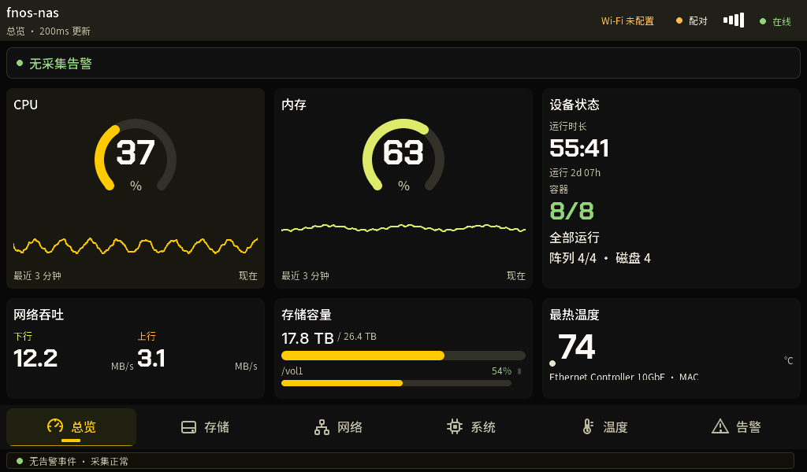

## 存储

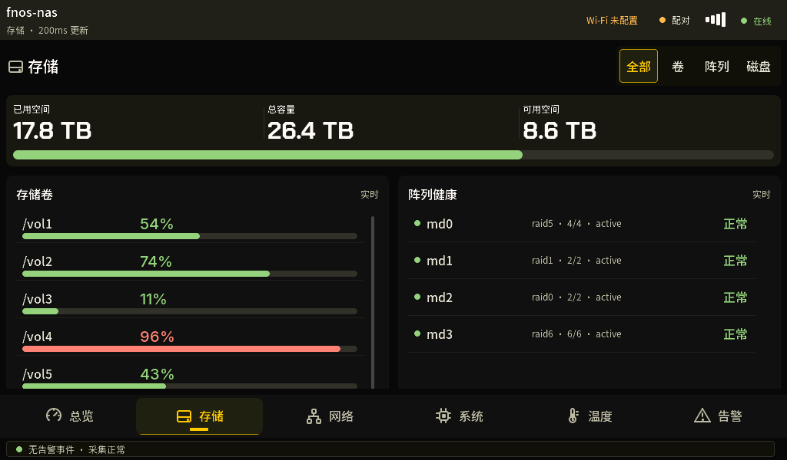

## 网络

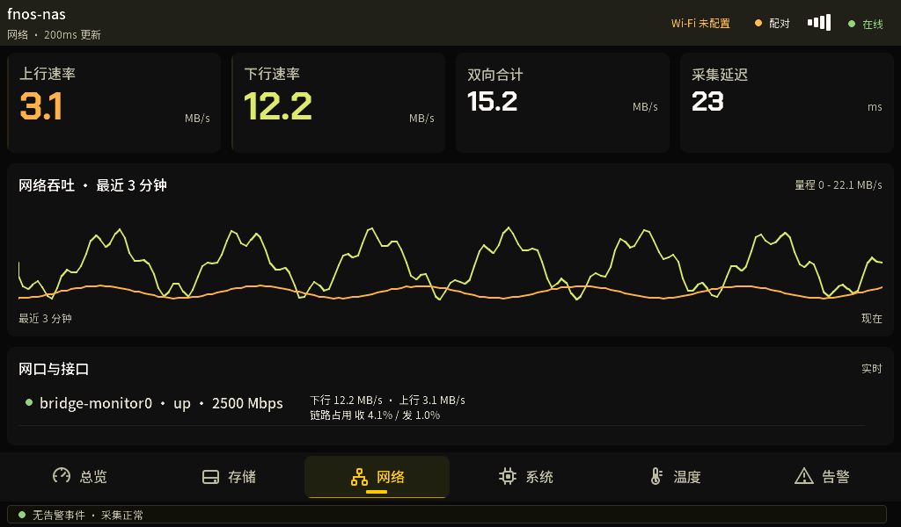

## 系统

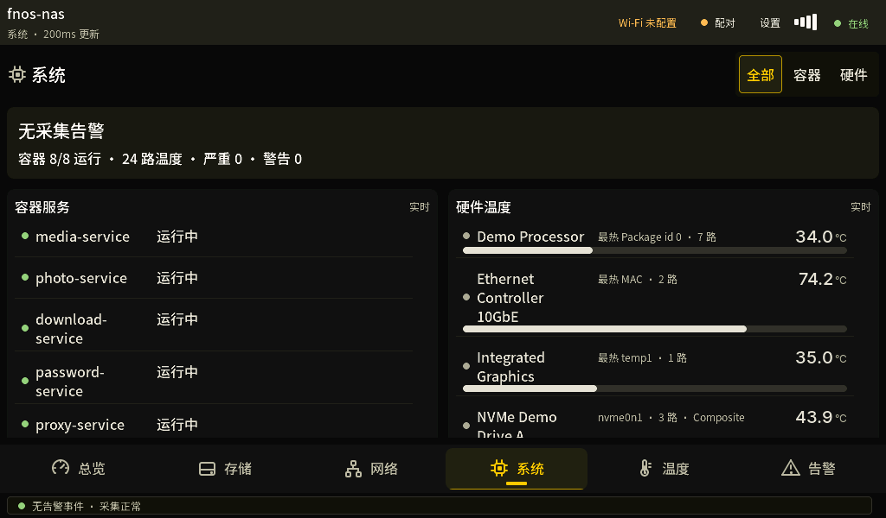

## 温度

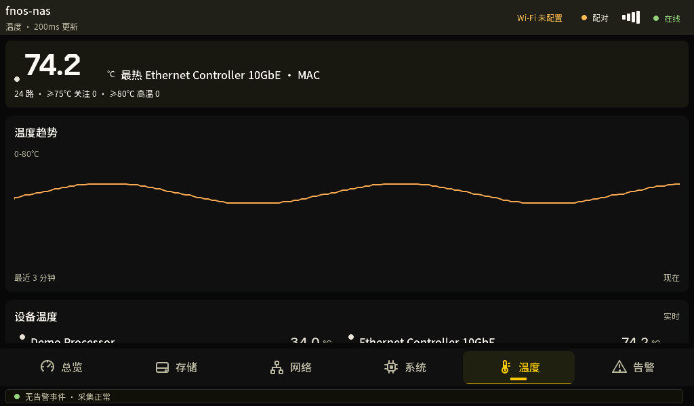

## 告警

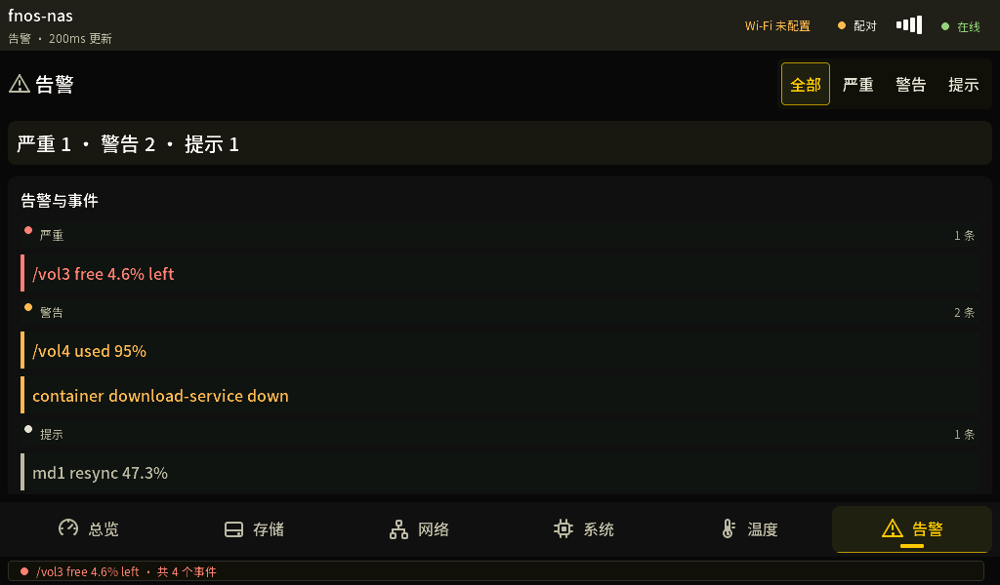

## Wi-Fi 扫描

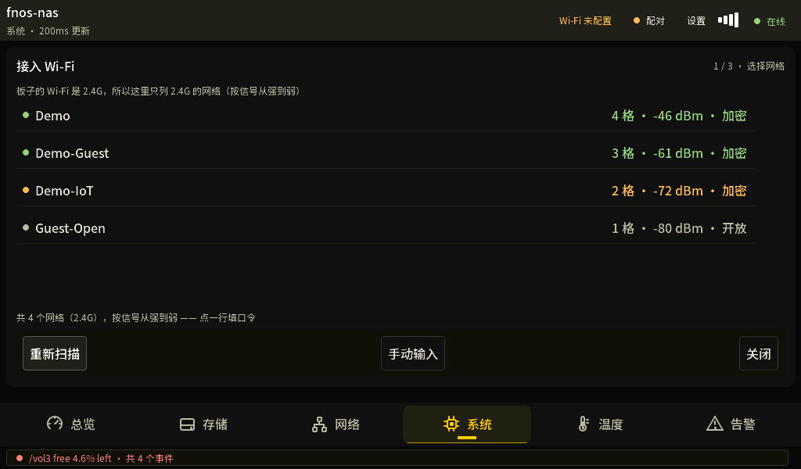

## Wi-Fi 键盘

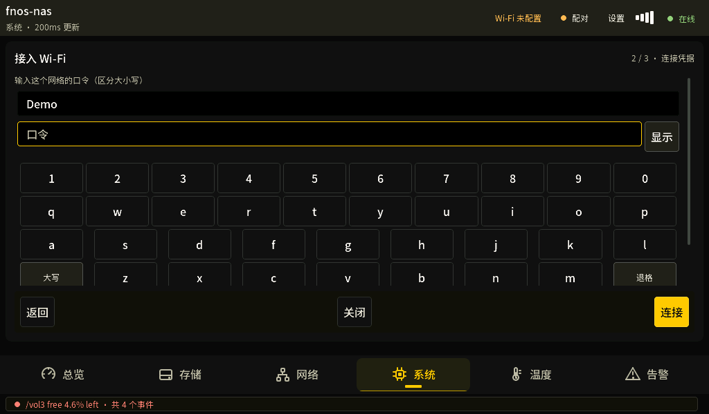

## 配对码

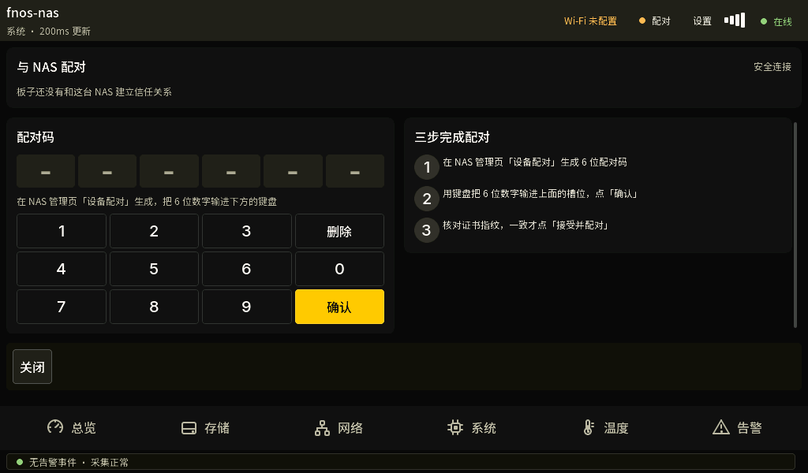

## 证书核对

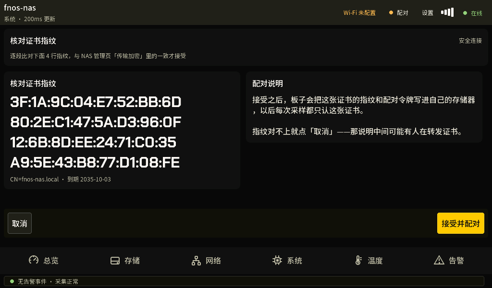

## 卷详情

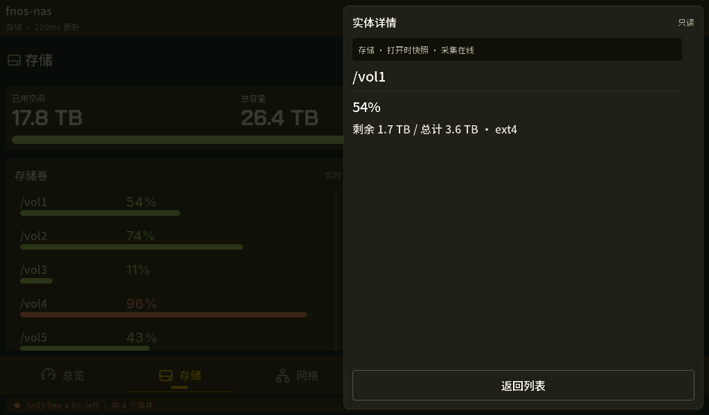

## 容器详情

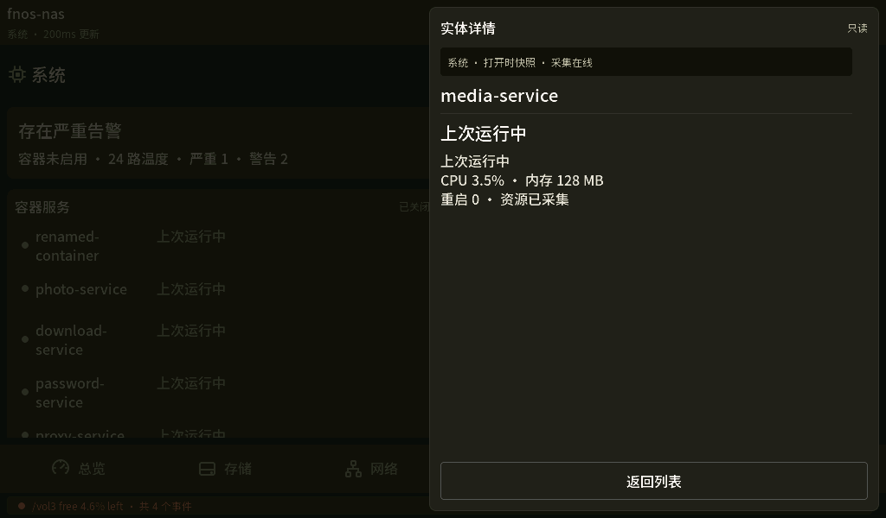

## 设置与诊断

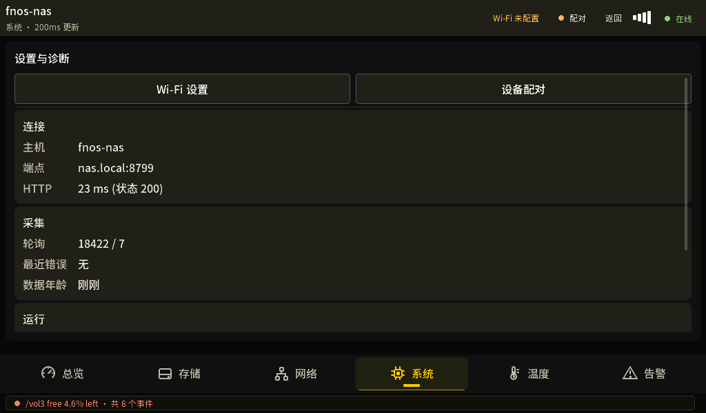

## 夜间总览

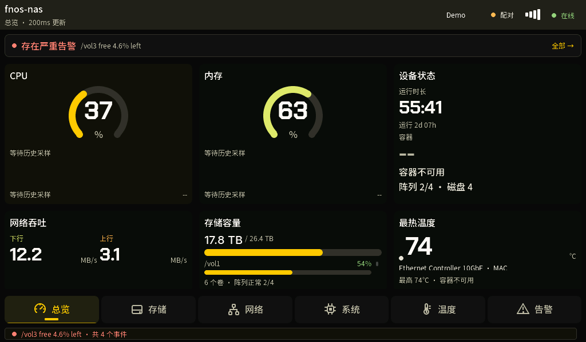

## 无告警体检

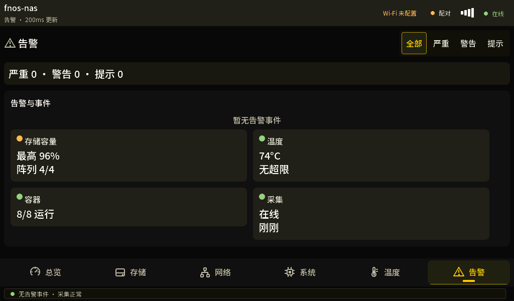
