# 酷态科参考图校正版 · 2026-10-14

> 历史快照图册：保留候选对比，源码哈希仅表示捕获时状态。当前默认版及可复现命令见 [ULTRA 图册](../ui-cuktech-ultra-2026-10-14/README.md)，本页旧命令不能重建旧图。

按用户提供的两张产品屏幕图片修正：中性炭灰底、白色读数、局部黄/青/橙与独立状态绿。15 张 1024×600 原生 LVGL 图使用匿名模拟数据；不是实屏验收。

历史命令：`KK_PALETTE=cuktech-console bash tools/preview/run.sh out-cuktech-photo-20261014`。同名主题已按用户 ULTRA 参考图及“黄色改蓝色”继续更新，此命令不能重建本页旧图；当前参考版见 [ULTRA 图册](../ui-cuktech-ultra-2026-10-14/README.md)。

[设计与验证](../../ui-cuktech-photo-reference-2026-10-14.md) · [上一版黄绿候选](../ui-cuktech-console-2026-10-14/README.md) · [源码/图片指纹](manifest.json)

## 总览

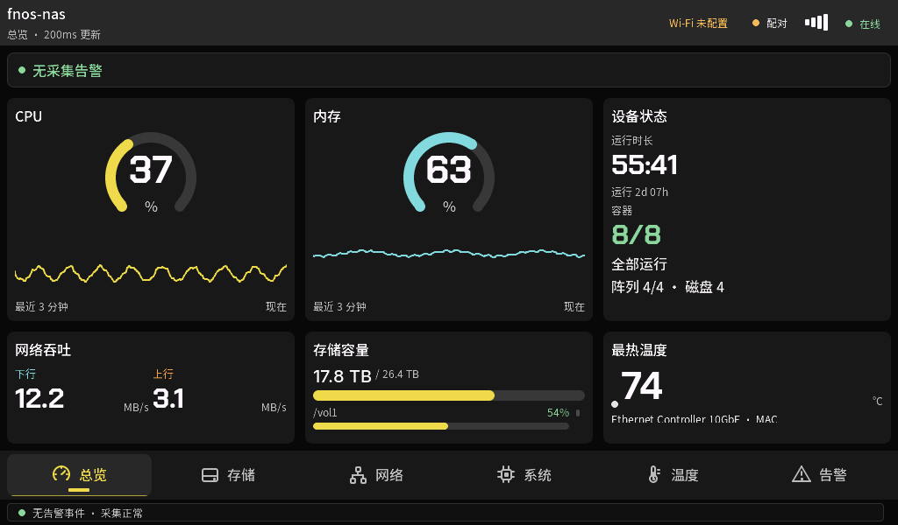

## 存储

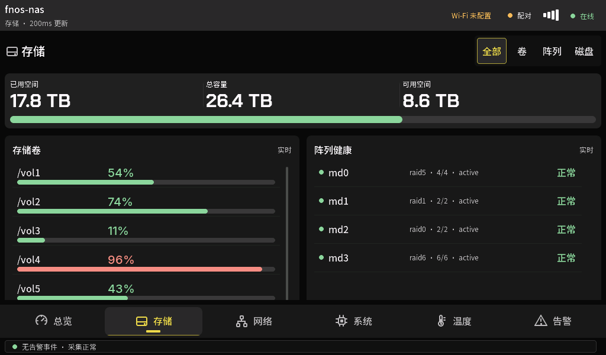

## 网络

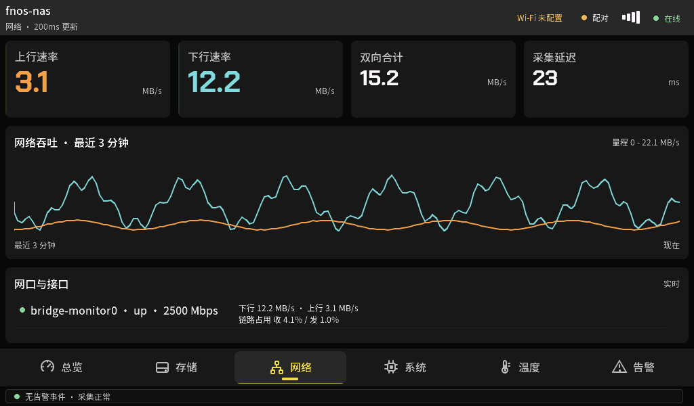

## 系统

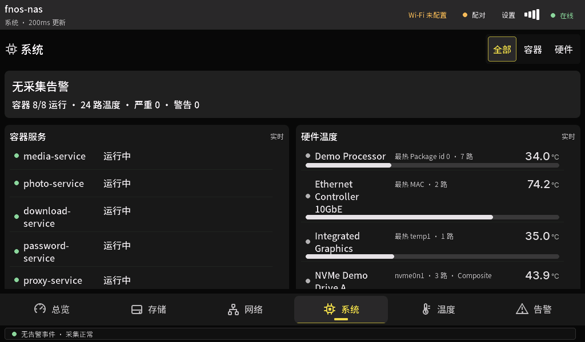

## 温度

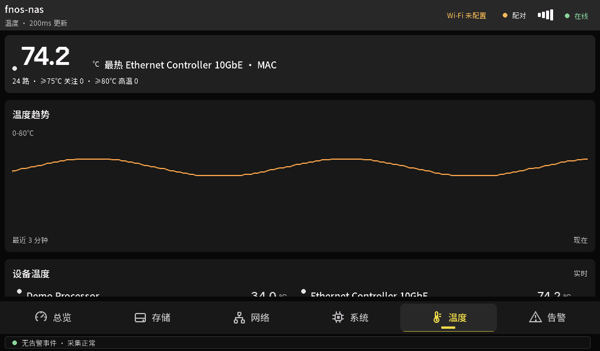

## 告警

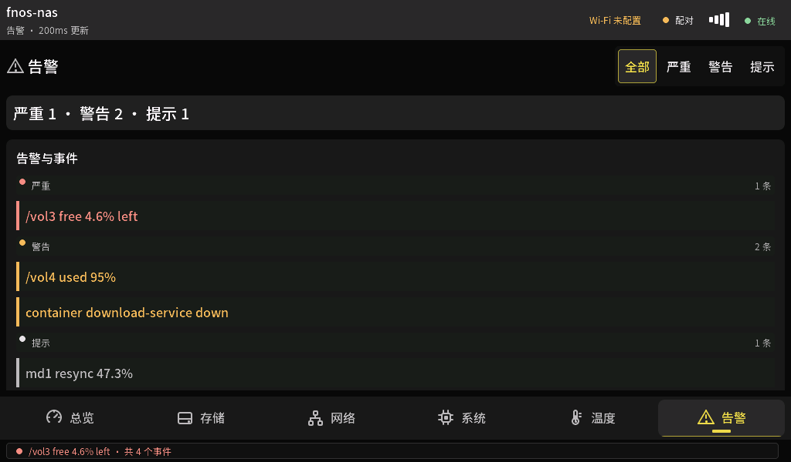

## Wi-Fi 扫描

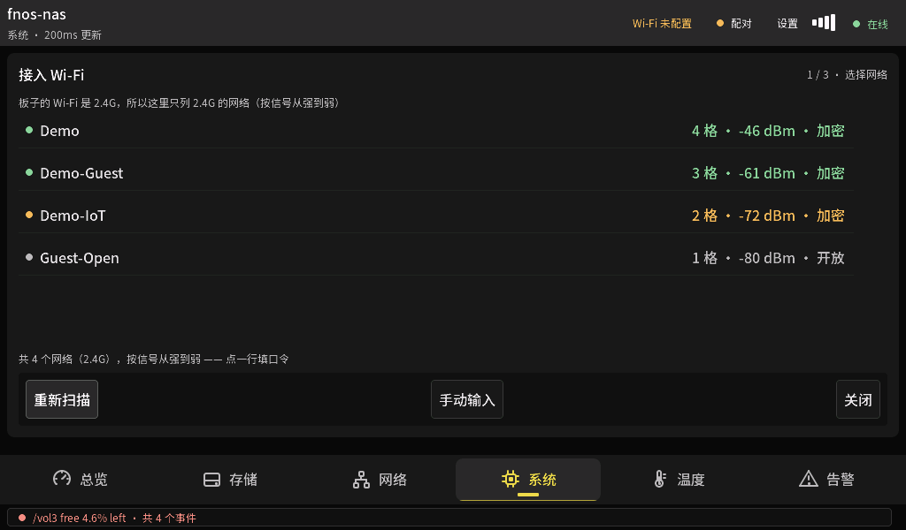

## Wi-Fi 键盘

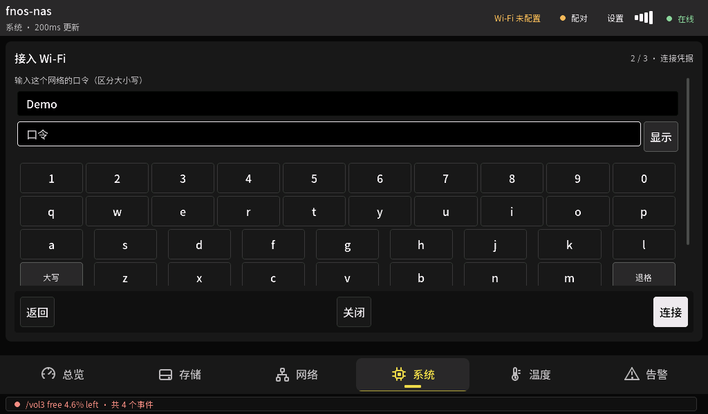

## 配对码

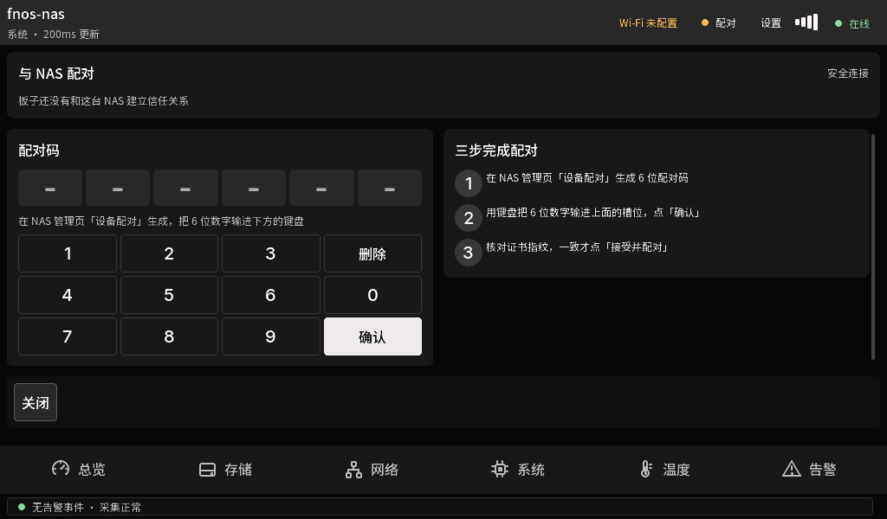

## 证书核对

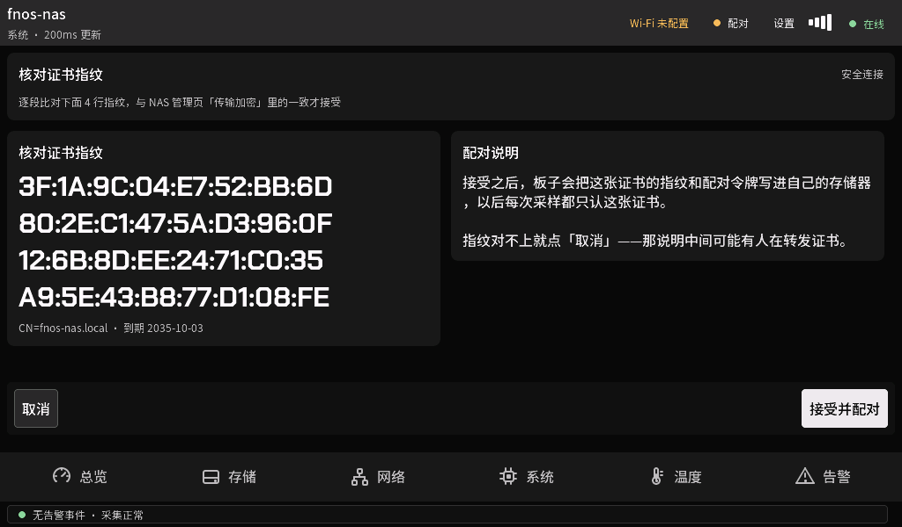

## 卷详情

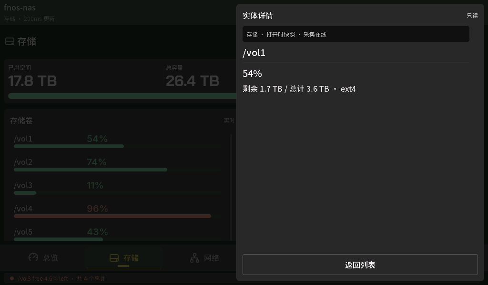

## 容器详情

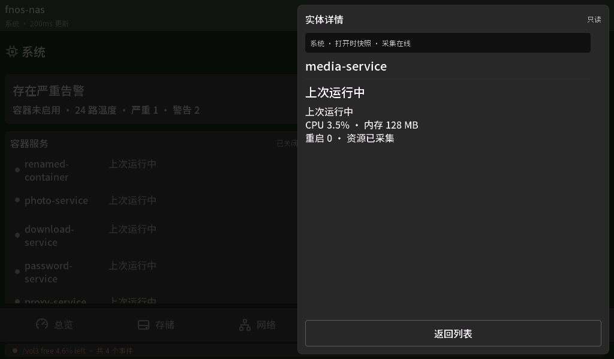

## 设置与诊断

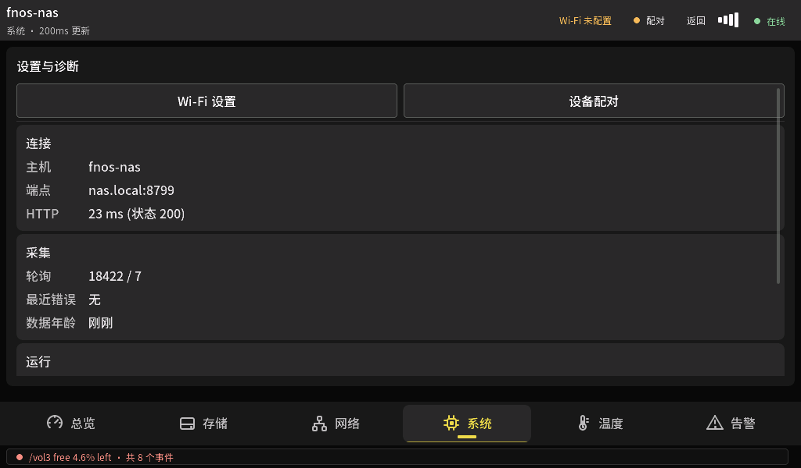

## 夜间总览

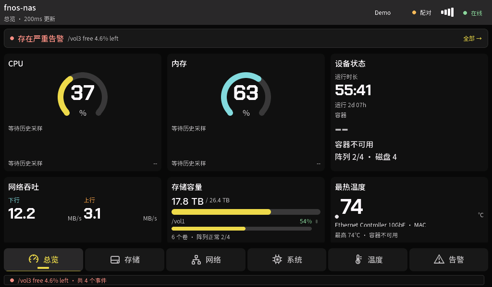

## 无告警体检

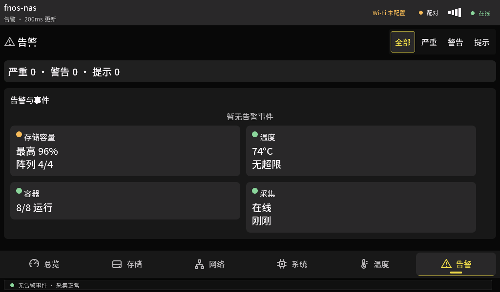
