# michka 石板灰主题 · 产品图（2026-11-02 重渲染）

近黑画布、灰色气泡卡片、居中的方块帽标题、Inter 等宽数字；青绿=正常、蓝=内存/主型号、冰青=下行/温度、橙=上行/告警。15 张原生 LVGL 1024×600 图采用匿名夹具，含六页、输入与配对、详情、诊断、夜间。这些图是主机渲染，不代表实屏验收。其中 `alerts.png` 与 `health-summary.png` 是同一帧（两文件字节相同）：告警页无事件态时，2×2 体检摘要就画在同一屏上。

本批图于 2026-11-02 用源码基线 `6ae531d`、LVGL 9.6 重新渲染。诊断页共 11 行，截图可见前 9 行，运行组的「采集段」与「动效」需滚动查看。

目录名沿用 2026-10-22 的视觉基线；主题与布局记录见[设计与验证](../../ui-michka-slate-2026-10-22.md)。

复现：`KK_PALETTE=michka bash tools/preview/run.sh out/render-2026-11-02`。

[设计与验证](../../ui-michka-slate-2026-10-22.md) · [源码/图片指纹](manifest.json)

## 总览

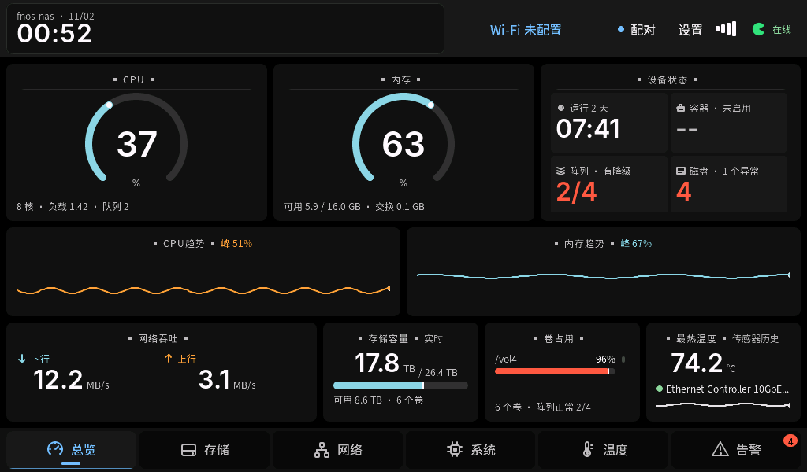

## 存储

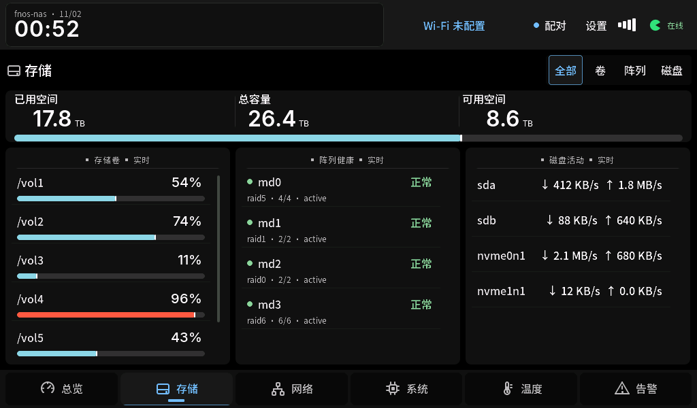

## 网络

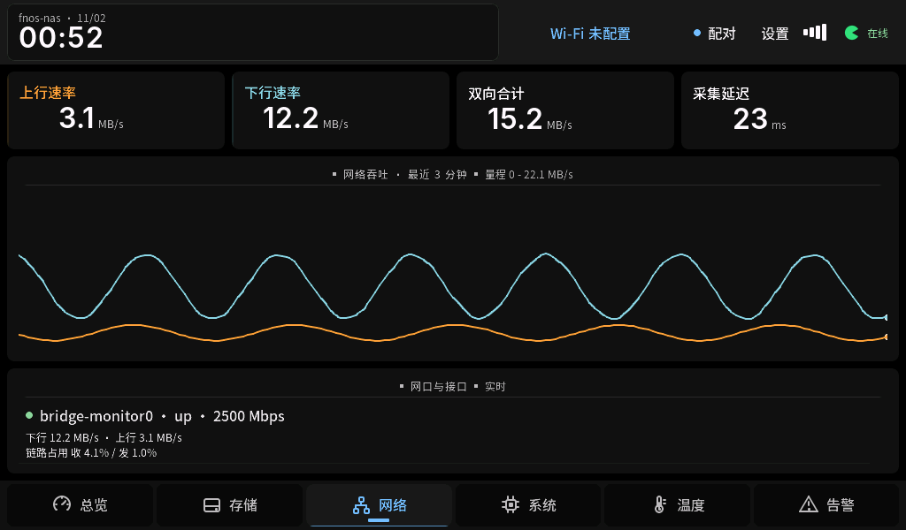

## 系统

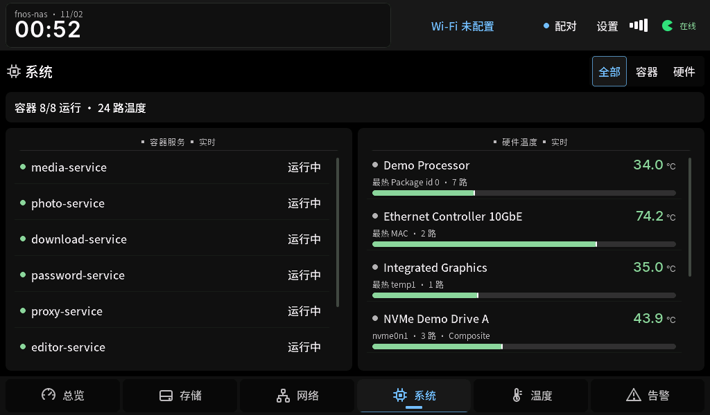

## 温度

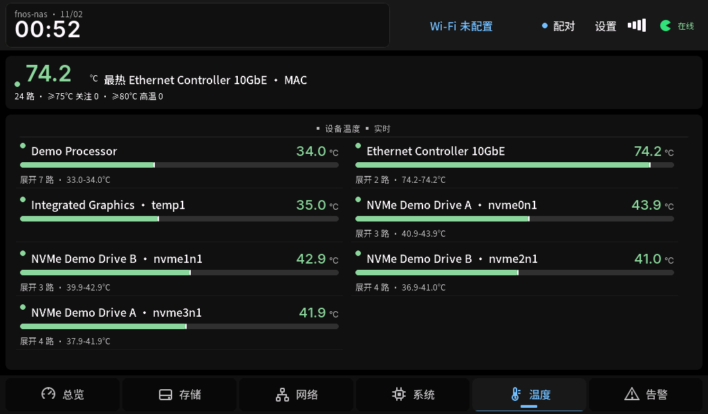

## 告警

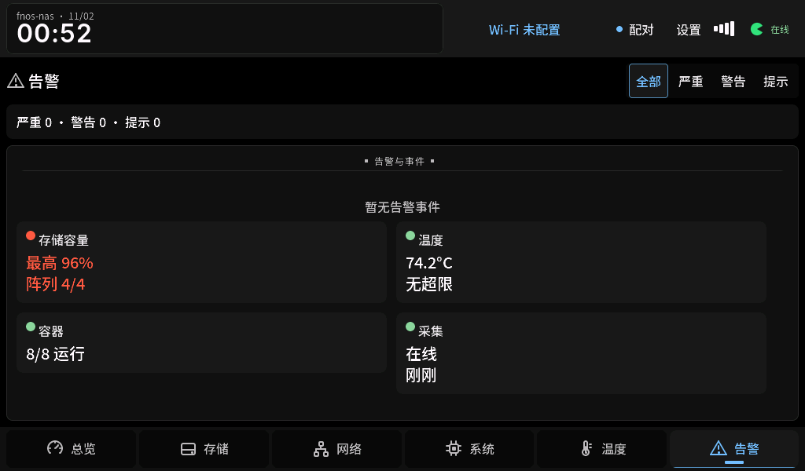

## 首次连接与配对

| 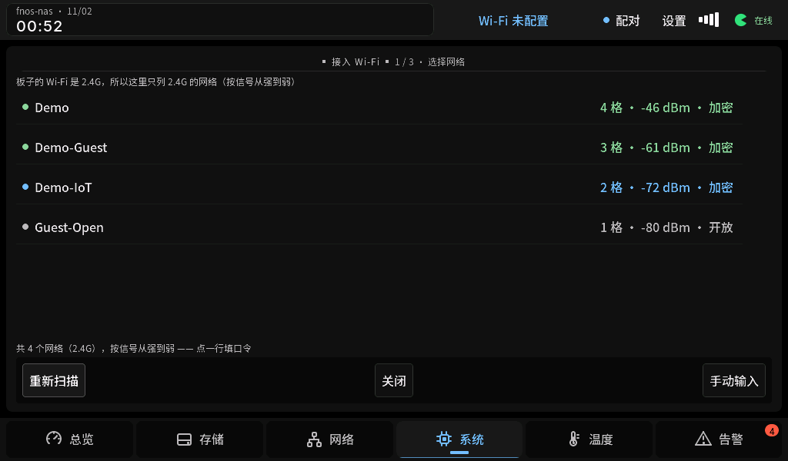 | 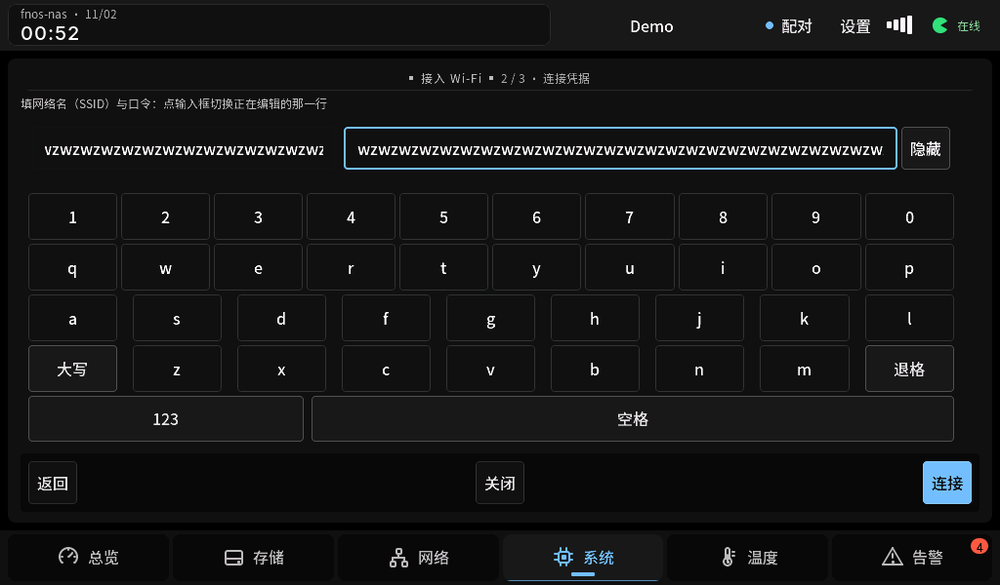 |
| --- | --- |
| 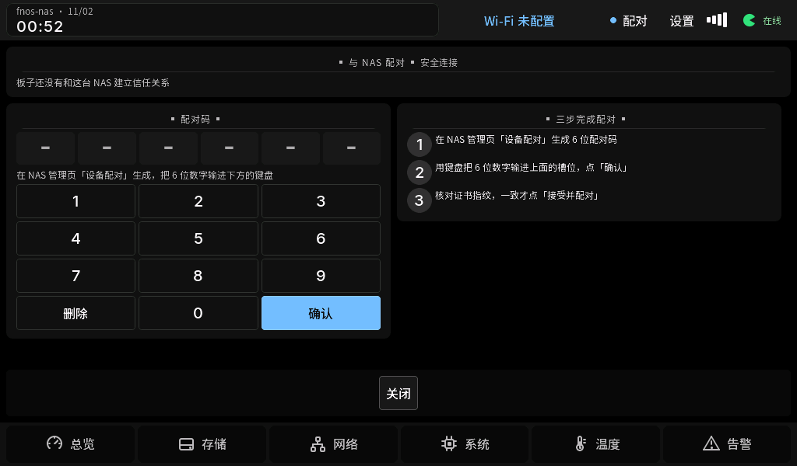 | 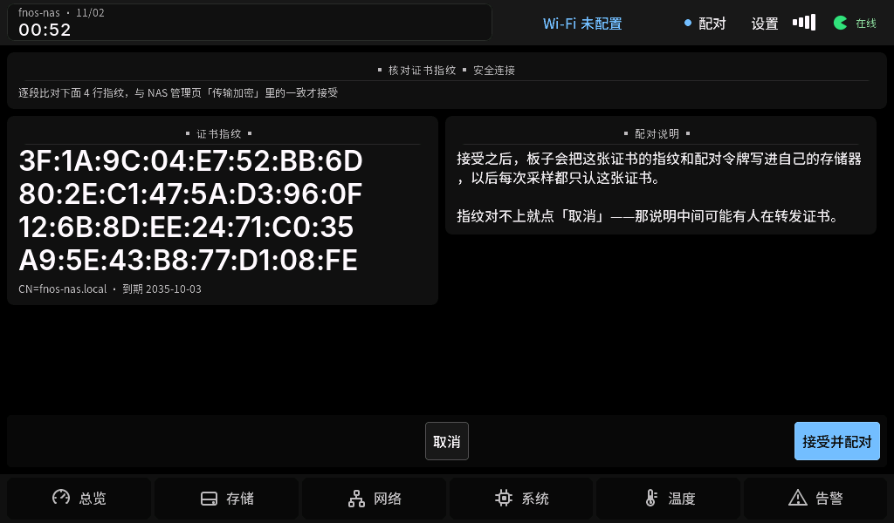 |

## 详情与诊断

| 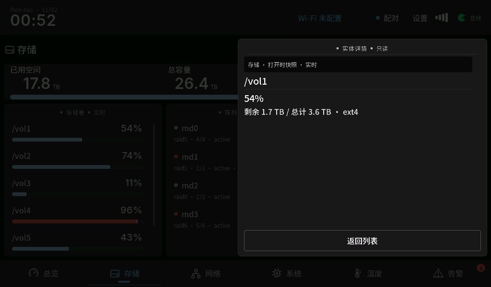 | 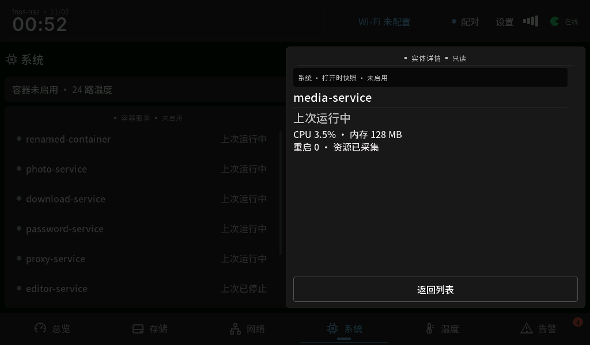 |
| --- | --- |

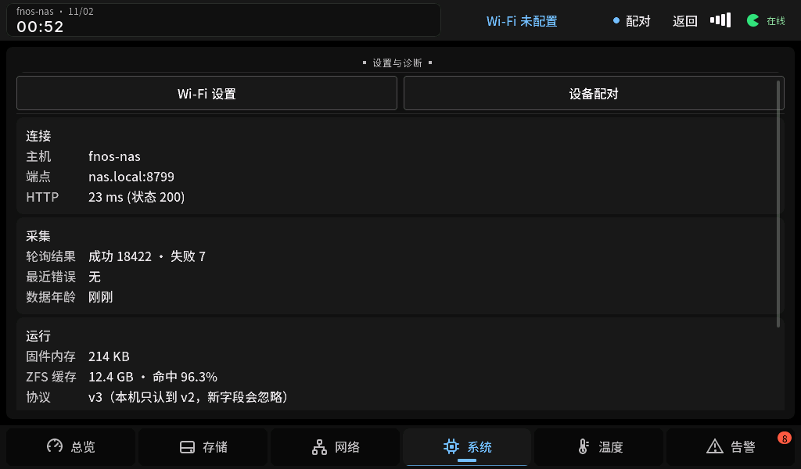

## 无告警与夜间

|  | 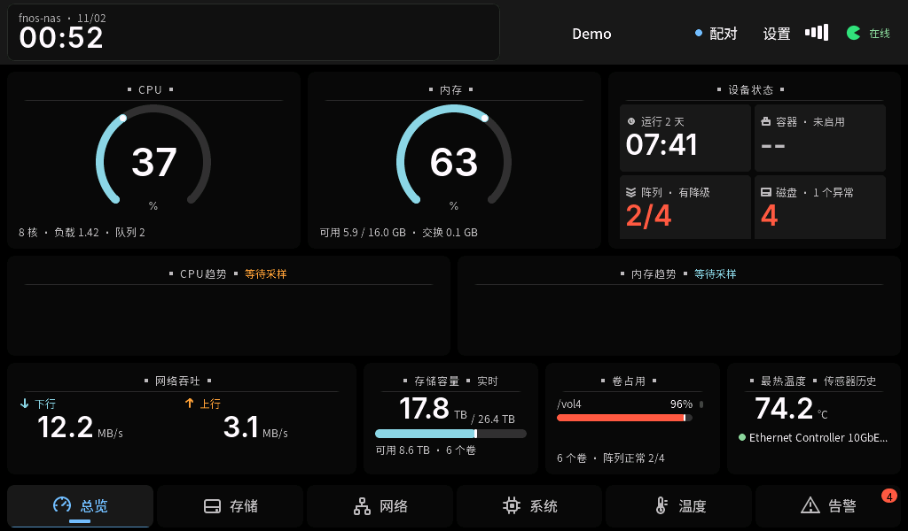 |
| --- | --- |
