# UniFi 深色候选版 · 2026-10-14

> 历史快照图册：保留候选对比，源码哈希仅表示捕获时状态。当前默认版及可复现命令见 [ULTRA 图册](../ui-cuktech-ultra-2026-10-14/README.md)，本页旧命令不能重建旧图。

15 张 1024×600 原生 LVGL 渲染图，使用匿名模拟数据；不代表实屏验收。

通过 `KK_PALETTE=unifi bash tools/preview/run.sh out-unifi-dark-20261014` 复现。默认仍为 `cuktech`，上一版图册保留于 [暖中性版](../ui-2026-10-14/README.md)。

设计与验证见 [候选记录](../../ui-unifi-dark-2026-10-14.md)。源码与图片指纹见 [manifest](manifest.json)。

## 总览

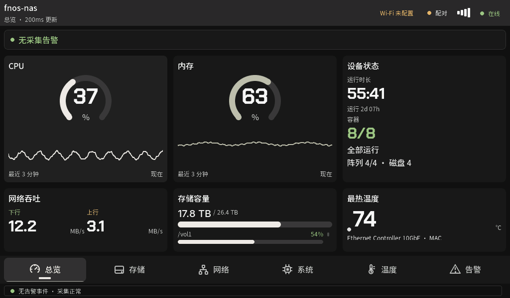

## 存储

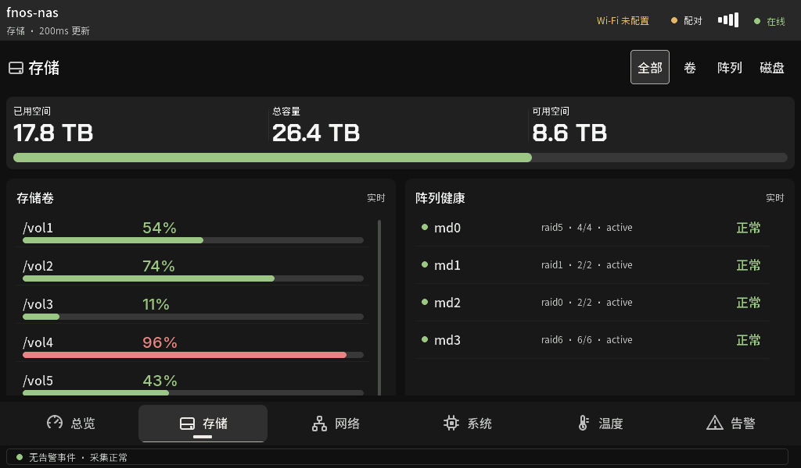

## 网络

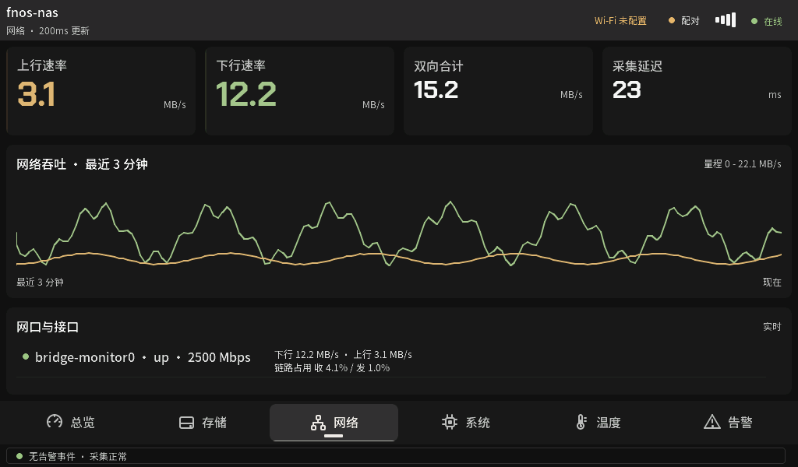

## 系统

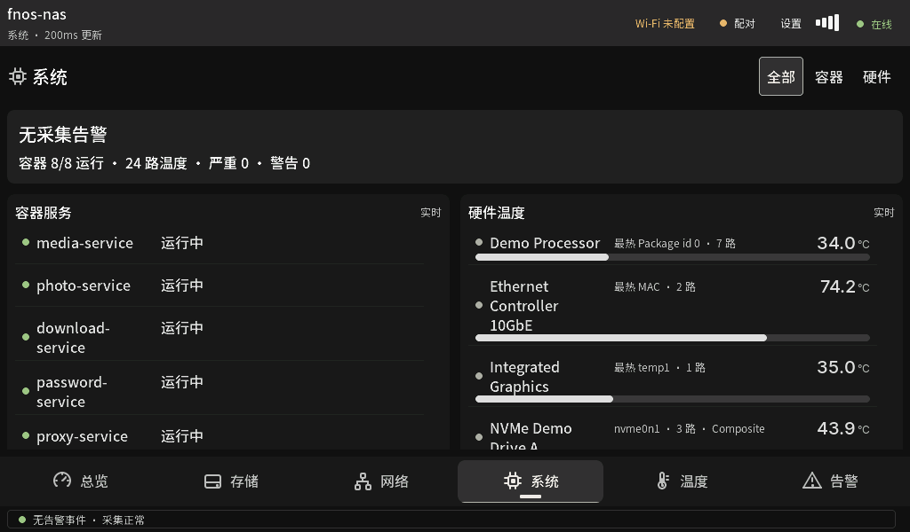

## 温度

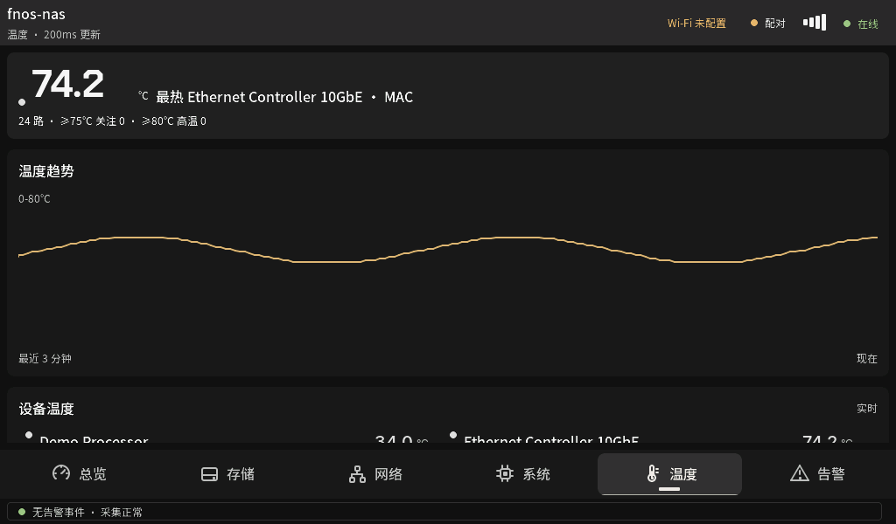

## 告警

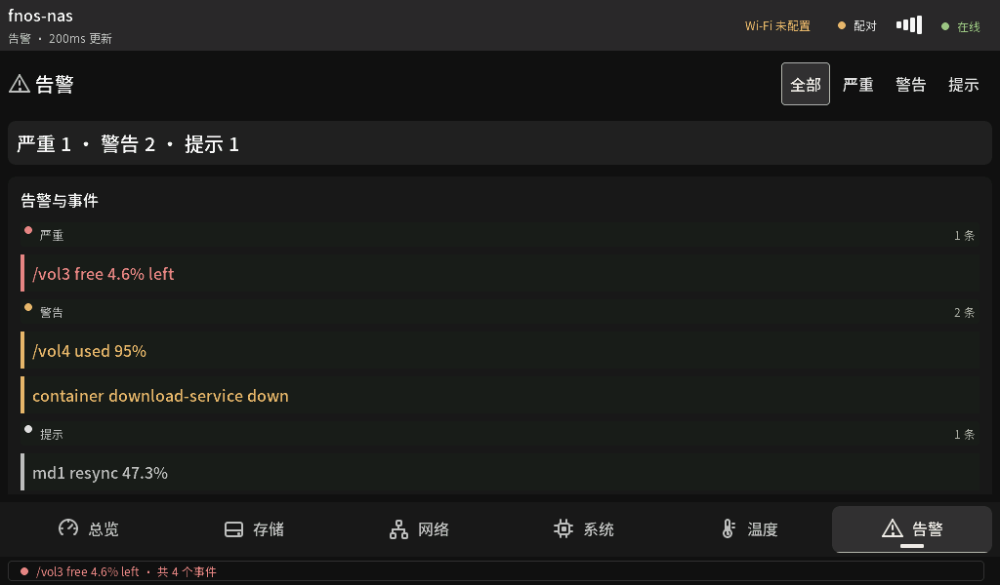

## Wi-Fi 扫描

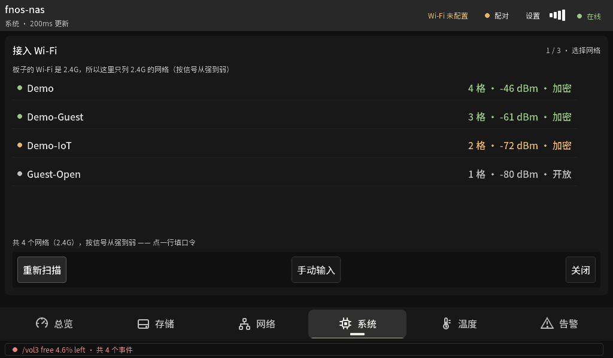

## Wi-Fi 键盘

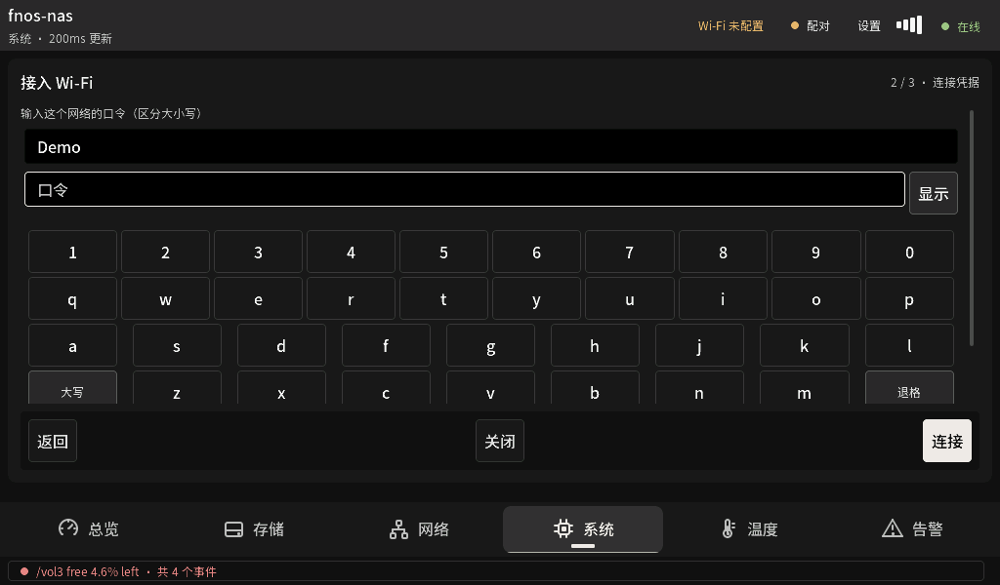

## 配对码

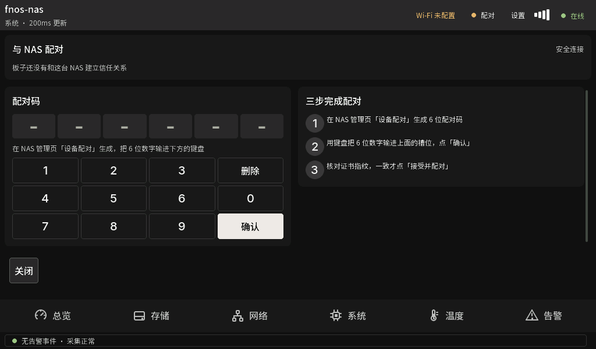

## 证书核对

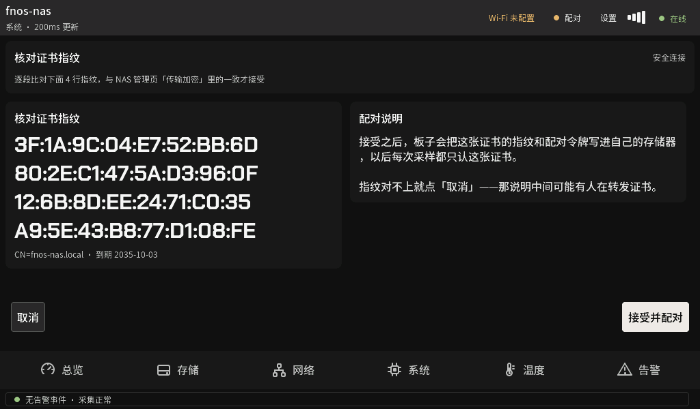

## 卷详情

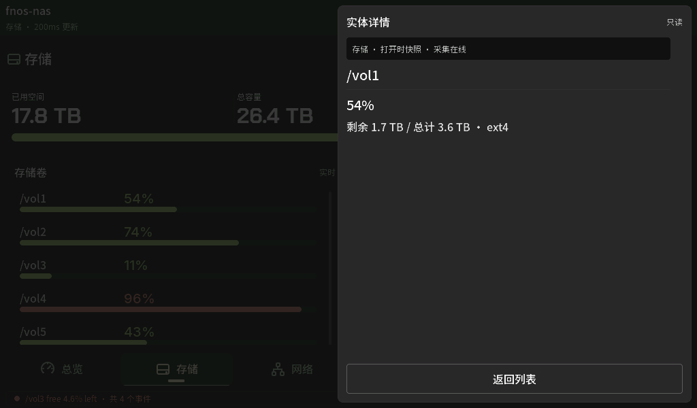

## 容器详情

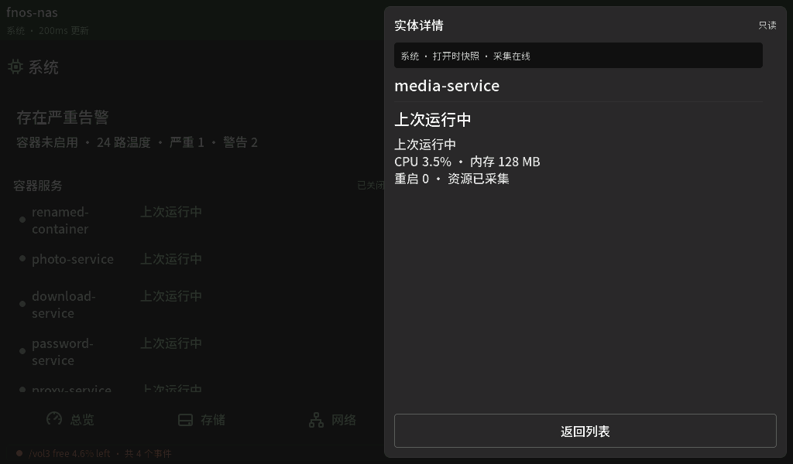

## 设置与诊断

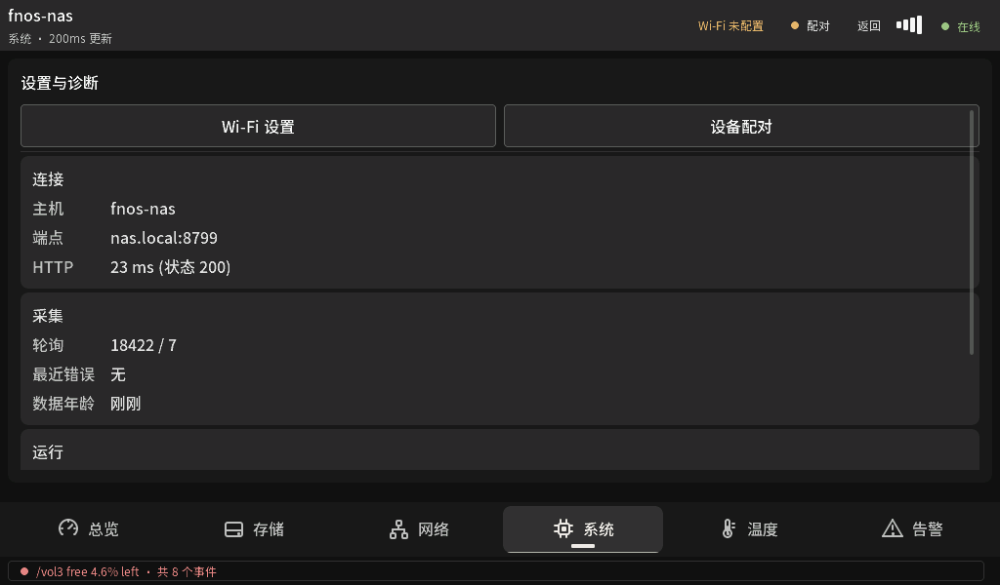

## 夜间总览

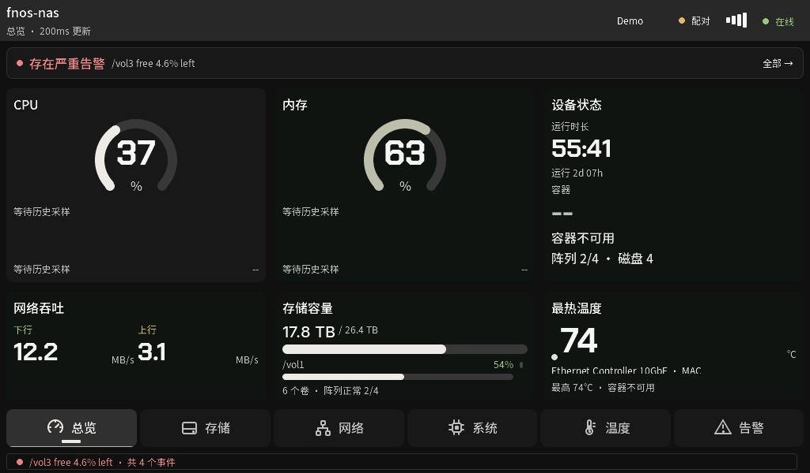

## 无告警体检

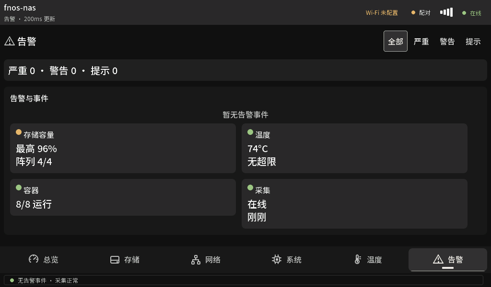
